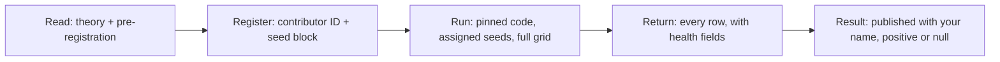

# Contribute: Run a Registered Experiment

**If you found this page through the SJÄLV booklet's QR code: this is how a computer-science student can help test the Four-Model Theory, and why you need to register before you run anything.**

The theory is published as an open record on Zenodo ([doi:10.5281/zenodo.18669891](https://doi.org/10.5281/zenodo.18669891)). The experiments that test it in code come from a programme called **crucible**. This page explains both briefly, lists the experiments that are pre-registered, and states which ones an outsider can run today.

!!! abstract "Start here in 3 steps"
    1. **Read.** The plain-terms summary below, then the [Four-Model Theory](../core-architecture/four-model-theory.md) article (10 minutes).
    2. **Register.** Open a contributor registration before you run anything: `{{TBD-crucible: registration link (GitHub issue template + form)}}`. You get a contributor ID and a block of seeds.
    3. **Run.** Pick an experiment marked *open* in the table below, run it with your assigned seeds at the pinned code version, and send the rows back in the return format.

---

## What FMT claims, in plain terms

The Four-Model Theory (FMT) says a conscious system runs models of itself and of its world, and it sorts those models into **four kinds** along two axes:

- **Scope:** a model is about the *world* or about the *self*.
- **Mode:** a model is *implicit* (stored in the substrate, such as learned weights and body schema) or *explicit* (a running, transient simulation).

That gives four kinds: implicit world model, implicit self model, explicit world model and explicit self model. They are four *kinds*, not four modules you could unplug separately.

Two claims matter for experiments:

1. **What enables consciousness.** The system needs *free modeling*: open-ended computation used for autonomous modeling, plus the four model kinds. Near-critical ("edge of chaos") dynamics are a *signature* this often leaves in brains. They are **not** a requirement, and they never imply consciousness on their own ([Criticality: Signature, Not Requirement](../physical-foundations/criticality.md)).
2. **What experience is.** Experience arises when information from the implicit models is integrated into the explicit models and fed to the explicit self model, which then treats itself as the being it occupies. The loop through which the self model feeds back on itself is called **closure** ([Self-Referential Closure](../core-architecture/self-referential-closure.md)).

The engineering question follows directly: if you build a system with these parts, does closure do measurable work, and what does it cost? crucible tries to answer that with small, falsifiable experiments: rate networks, spiking networks, simulated bodies and one small quadruped robot.

**What has not been shown.** Nothing in crucible is claimed to be conscious, and the robot at the MoC7 booth is not conscious by the theory's own criterion. The self/world split in the current spiking substrate is hand-assigned, so no result yet shows that a system *produces* that split itself. The programme has also killed or nulled several of its own claims (five failed tests of closure *necessity*, among others). Those negatives are part of the record, and they are why the surviving results carry any weight.

## Registered experiments

"Registered" means the hypothesis, the falsifier and the analysis were written down and committed *before* the code that produces the data existed. Status is reported as measured, including nulls.

### Open, or opening, to outside contributors

| ID | Question | Hypothesis | Falsifier | Status | What you need |
|---|---|---|---|---|---|
| **CRU-70** | Does a longer return path for the self-loop cost *function*, and not only wiring? | At the same operator and the same spectral radius, loop-transit fidelity falls monotonically as the relay length *k* grows. | Spearman(*k*, fidelity) > −0.80 over *k* ∈ {1, 2, 3, 4, 6, 8}, **or** fidelity at *k* = 8 not below *k* = 1 in at least 7 of 8 seeds. | **Done, confirmed** (Spearman −1.000, 8/8 seeds). A size-matched control added *after* the run attributes about 60% of the drop to state size and about 40% to latency. That control was not pre-registered. **Open for independent replication** on fresh seeds, and for a pre-registered version of the size-matched control. | Laptop CPU, Python 3.11+, numpy. The original run took 19 s. |
| **CRU-78** | Can a self-model block own the network's dominant dynamical mode under strong recurrence as the network grows? | Pre-registered as a **negative**: no self-block-localized dominant mode survives at size *N* ≥ 1760. | The negative dies if any cell with *N* ≥ 1760 has ≥ 25% of its 8 seeds passing the 0.5 localization gate. | **Done. The negative was falsified** (36 cells passed). A follow-up control then showed that the surviving positive is mostly *block dominance*: the block with the larger spectral radius owns the mode. The pre-registered verdict on that control is PARTIAL, so this is **not** evidence for closure. **Open for replication** of the control. | Control: CPU, 128 configurations. Full confirmatory grid: a GPU (about 95 min on an RTX 4090 for 640 configurations). |
| **KIT-S0** | At which learning rate does a plastic spiking network stay healthy as it grows? | *Calibration, not a hypothesis test.* A trained run counts as healthy if its weight growth stays near 1 and its firing rate stays near the frozen run's rate. | None (calibration). Unhealthy rows must be **reported, not dropped**. | Measured in-house up to 15,360 neurons. Sizes ≥ 30,720 are being run by one outside collaborator. **Opens when the code is public.** | A large GPU. `{{TBD-crucible: VRAM per network size for this kit}}` |
| **KIT-S1** | Does a frozen spiking network carry more information about its *own* body as it gets bigger? | The network's contribution to predicting its own body grows with network size. | `{{TBD-crucible: falsifier — this axis is not yet formally pre-registered}}` | **Null so far.** For typical seeds the contribution is flat (median ≈ 0.20) from 960 to 15,360 neurons, and training adds nothing at any size. A readout that overfits a hard body stream would produce the same pattern. Sizes ≥ 30,720 are untested. **Opens after pre-registration.** | Runs after KIT-S0 on the same hardware. |
| **R1** | Where does a reactive, symbol-free robot controller sit on the branching-ratio scale while it does a real task? | `{{TBD-crucible: stated hypothesis}}`. The stakes are already stated: if a purely reactive controller sits at σ ≈ 1 while performing well, near-criticality fails as a *marker* of the interesting regime, and that result would be reported against the programme. | `{{TBD-crucible: falsifier, which depends on the event definition (CRU-192)}}` | **Not open yet.** The naive estimator reads σ ≈ 1 on *any* smooth motor trace, so an event definition and a positive control are needed before anyone records data. | A real robot (legged or wheel-legged) running a reactive controller, plus per-timestep logs of motor commands or behaviour switches and the task outcome. No crucible code is needed. |

### Registered, but not open to outsiders yet

The following experiments are listed so that you can see the whole programme. They depend on design decisions that are still open, or on the in-house robot and hardware.

| ID | Question | Status |
|---|---|---|
| **CRU-83** | Does the closure loop *build* the self model (sufficiency)? This is the programme's main open target. | First gate passed (a local learning rule reaches 92.4% of the hand-wired ceiling, *p* = 0.0001, 8 seeds). The spiking build is still gated because its pre-registered predictions are not yet filled in. |
| **CRU-176** | Does a learned self-label stay attached to the self when the self-referential loop is opened? | The first run was a negative control. It was **inconclusive**: two of four clauses passed, one is vacuous on this substrate, and one needs more seeds. |
| **CRU-210** | Does the self circuit's forward prediction separate the robot's own motion from motion of the world? | The prompting observation is unregistered. Design is in progress. |
| **CRU-76** | Does the system selectively suppress an antecedent *because* it recurs? | Pre-registered, then **killed before it was built** by an adversarial review. Listed so the kill is visible. |

The theory also makes predictions about human experience (psychedelics, anosognosia, lucid dreaming). Those need a lab, not a laptop. See [Predictions](../predictions/prediction-1-anosognosia.md).

## Why you must register first

Unregistered runs cannot count, even if they are done well. There are three reasons.

1. **Pre-registration integrity.** If a result can come from someone who ran many seeds and reported the good ones, it says nothing. The programme fixes the whole grid in advance: no early stop on a positive, no extra seeds after seeing data, no widening an axis to find a region where the claim holds. A registered contributor gets a **seed block allocated in advance**. That is how a reader can tell your run from a search.
2. **Data provenance.** A returned row is usable only if it names the exact code commit, the pre-registration commit, the seeds and the hardware. This has already mattered. An early version of the run kit reported scores that looked like successful learning from circuits that had in fact been destroyed. Health fields are now mandatory in every row for that reason.
3. **Credit.** Registration is how your contribution gets recorded, so that your name is attached to the result your data enters, whether that result is positive or null.

## How to register

The mechanism does not exist yet. The planned form is:

- A **GitHub issue** from the template "Contributor registration" in `{{TBD-crucible: public repo URL}}`, or the form at `{{TBD-crucible: registration form URL}}` if you have no GitHub account.
- Fields: name, affiliation (a student ID is fine), contact e-mail, ORCID (optional), the experiment ID, your hardware, and how many seeds you plan to run.
- You receive: a contributor ID, a seed block, and the pinned code and pre-registration commits to run against.

Do not start a run before you have the seed block.

## Code, setup and the smallest runnable experiment

| What | Where |
|---|---|
| Code | `{{TBD-crucible: public repo URL}}`. crucible is private today, and its open-sourcing is being prepared. |
| Setup | Python ≥ 3.11 with numpy, scipy, gymnasium and scikit-learn for the CPU experiments. Spiking experiments add PyTorch and Norse and need a CUDA GPU. Install steps: `{{TBD-crucible: install instructions}}` |
| Smallest runnable experiment | **CRU-70 replication**: one script, CPU only, under a minute. Command: `{{TBD-crucible: exact command, e.g. python repro/cru70_return_latency.py --seeds <your block>}}` |
| Pre-registrations | `{{TBD-crucible: public path to docs/design/*-prereg.md}}` |
| Compute needs | CRU-70: any laptop. CRU-78 control: CPU, minutes to hours. KIT-S0 and KIT-S1: a large GPU. R1: a robot. |
| Data-return format | `{{TBD-crucible: data-return spec}}`. Proposed: JSON Lines, one row per cell, carrying your contributor ID, the experiment ID, the code commit, the pre-registration commit, the seed, the configuration, the dependent variable, the mandatory health fields, the hardware and the runtime. Return **every** row, including failed and unhealthy ones. |
| Data-return channel | `{{TBD-crucible: upload channel (e.g. pull request to a results repo, or Zenodo community)}}` |
| Licence | Code: `{{TBD-crucible: code licence}}`. Returned data: `{{TBD-MG: data licence}}`. This wiki is CC BY 4.0. |

## What you get back

- **Credit.** Your contributor ID and name in the result document that uses your rows.
- **Co-authorship.** `{{TBD-MG: co-authorship rule — threshold for authorship vs acknowledgement}}`
- **Your result, whatever it is.** A failed replication is reported as one. If your run falsifies a registered claim, the claim is dead, and that is recorded with your name on it.

## Ground rules

- **No changing the hypothesis after seeing data.** If you think the pre-registration is wrong, say so and propose an amendment *before* you run, or report your run against the registration as written.
- **Report nulls.** Null and negative results are returned and published on the same footing as positives. Do not drop unhealthy or odd rows. Report them and flag them.
- **Run the declared grid in full.** No early stopping, no added seeds, no extra axes.
- **Ask what a null would look like.** Every claimed effect needs an answer to the question "what would this result be if no mechanism were present?". If the answer is "exactly this", the result is not evidence.
- **Open licence.** Code and data go out under the licences named above once they are fixed.

## Figure

*Contribution flow: read the theory and the pre-registration, register to receive a contributor ID and a seed block, run the pinned code on your seeds over the full declared grid, return every row with its health fields, and the result is published with your name whether it is positive or null.*

## Key takeaway

Pick an experiment marked open, register before you run, run exactly what was registered, and send everything back, including the nulls. A run that was not registered cannot be told apart from a search, so it cannot count.
