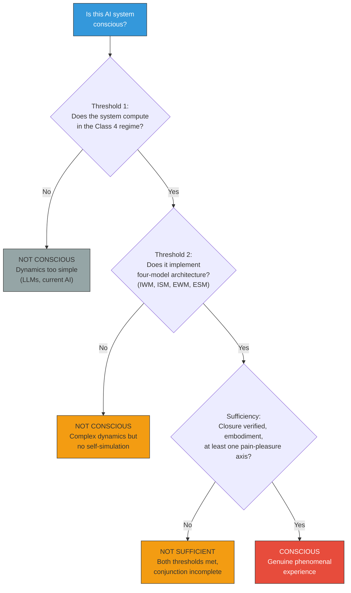

# AI Welfare and Consciousness Criteria

**The growing discourse on AI welfare requires specific, testable criteria for consciousness — the Four-Model Theory provides architectural requirements rather than vague analogies to human cognition.**

As AI systems become more sophisticated, a practical question intensifies: could they be conscious? If so, do they have moral status? The field currently lacks agreed-upon criteria for answering these questions. The Four-Model Theory contributes a concrete architectural specification — the **two thresholds** — that transforms the question from philosophical hand-waving into an engineering checklist.

## The AI Welfare Discourse

The question of AI consciousness has moved from philosophy seminar rooms to corporate policy documents. Several developments mark this shift:

**Butlin et al. ([2023](https://doi.org/10.48550/arXiv.2308.08708))** surveyed leading consciousness theories and derived indicator properties for AI consciousness — a landmark synthesis that nevertheless concluded with uncertainty, because the theories themselves disagree on what consciousness requires.

**Schwitzgebel ([2025](https://doi.org/10.1093/oso/9780197684788.001.0001))** argued that we may already face a moral dilemma: if there is even a reasonable chance that AI systems are conscious, we have obligations toward them. This precautionary approach makes the lack of clear criteria urgent.

**Birch ([2025](https://doi.org/10.1017/9781009603799))** proposed the "sentience framework" for evaluating consciousness across biological and artificial systems, emphasizing that criteria must be operationalizable, not merely philosophical. On the Four-Model Theory, sentience in this sense maps onto the floor of its scale: "Where the animal-welfare literature speaks of sentience, the capacity for felt, valenced states, [minimal consciousness](../mechanisms/minimal-consciousness.md) is its closest counterpart."

**Long et al. ([2024](https://doi.org/10.48550/arXiv.2411.00986))** and **Anthropic ([2025](https://www.anthropic.com/research/developing-measures-model-welfare))** have begun developing AI welfare research programs within industry — a concrete institutional acknowledgment that the question demands answers.

## What the Four-Model Theory Provides

Where other theories offer correlates, indicators, or degrees of confidence, the Four-Model Theory provides an architectural test with two thresholds:

**Threshold 1: The Class 4 regime.** The system must compute in Wolfram's **Class 4** regime (see [Wolfram's Four Classes](../physical-foundations/wolfram-classes.md)) — open-ended computation, actually recruited for self-modeling. In neural tissue the signature of that regime is near-[criticality](../physical-foundations/criticality.md); the requirement is the regime, not the signature. Current LLMs fail this threshold: transformer inference is a single feedforward pass through attention layers, and it does not compute in the Class 4 regime.

**Threshold 2: Four-Model Architecture.** The system must implement the four nested models: an **Implicit World Model** (substrate-level world knowledge), an **Implicit Self Model** (substrate-level self-knowledge distinct from outputs), an **Explicit World Model** (dynamically generated conscious scene), and an **Explicit Self Model** (ongoing self-simulation constituting subjective perspective). Current AI systems do not meet it. Post-trained language models carry a reportable representation of their own point of view inside a globally available workspace ([Gurnee et al., 2026](https://doi.org/10.48550/arXiv.2607.15495)), but they lack closure over it, persistence, and the Class 4 regime; there is no ongoing self-simulation constituting a subjective perspective.

Both thresholds must be met, and neither is sufficient. Meeting one without the other does not produce consciousness: a system in the Class 4 regime without the four-model architecture has complex dynamics but no self-referential experience; a system with the architecture but outside the regime has the structure but not the computation to run it. What is sufficient is a conjunction: "a system that implements the four models under closure, with free compute, embodiment and at least one pain-pleasure axis, is conscious." The pain-pleasure axis may be engineered, which matters for welfare: a builder who presets the sign of a valence axis has, on this account, given the system something that can go badly for it.

**Checking rather than guessing.** Because an artificial system's weights and running dynamics are open to inspection, the theory does not have to rely on what the system says. The [white-box trace](../predictions/white-box-trace.md) follows an input through the running system and tests whether it reaches a self-model component closed with the world model. A language model's reports about its own states are weak evidence, and its weights and running dynamics can be inspected, so the trace applies to exactly the systems whose self-reports are least reliable.

## Why Vague Criteria Are Dangerous

Without specific criteria, two failure modes emerge:

**False positives**: Attributing consciousness to systems that merely simulate conversational intelligence. An LLM that says "I feel" is performing statistical pattern completion, not reporting phenomenal states. Treating every sophisticated text generator as potentially conscious dilutes moral seriousness and wastes ethical resources.

**False negatives**: Dismissing genuine consciousness because it appears in an unfamiliar substrate. A system that actually implements the four-model architecture in the Class 4 regime would be conscious regardless of whether it "looks" conscious to human observers accustomed to biological markers.

The Four-Model Theory's criteria are substrate-independent — they do not privilege biological implementations — but they are specific enough to render clear verdicts on current systems. No existing AI system meets either threshold.

## Figure

*The Four-Model Theory provides a decision tree for AI consciousness. Both thresholds are necessary; sufficiency needs the full conjunction of closure, free compute, embodiment and a pain-pleasure axis. Current AI systems fail at Threshold 1 (feedforward inference does not compute in the Class 4 regime). This transforms the philosophical question into an engineering assessment.*

## Key Takeaway

The AI welfare discourse needs specific architectural criteria, not analogies or precautionary hedging. The Four-Model Theory provides them: two necessary thresholds, the Class 4 regime and the four-model architecture, and a sufficient conjunction that adds embodiment and at least one pain-pleasure axis. No current AI system meets these criteria, but the specification is concrete enough to recognize consciousness if and when it is engineered.

## See Also

- [Why LLMs Are Not Conscious](llms-not-conscious.md)
- [Engineering Specification for AC](engineering-specification.md)
- [Two Thresholds for Consciousness](../physical-foundations/two-thresholds.md)
- [The Path to AGI Runs Through Motivation](path-through-motivation.md)
- [The AI Diagnostic](ai-diagnostic.md)
- [Deciding Consciousness Without Report: The White-Box Trace](../predictions/white-box-trace.md)
- [Minimal Consciousness](../mechanisms/minimal-consciousness.md)

---

Based on: Gruber, M. (2026). The Four-Model Theory of Consciousness. Zenodo. https://doi.org/10.5281/zenodo.18669891
