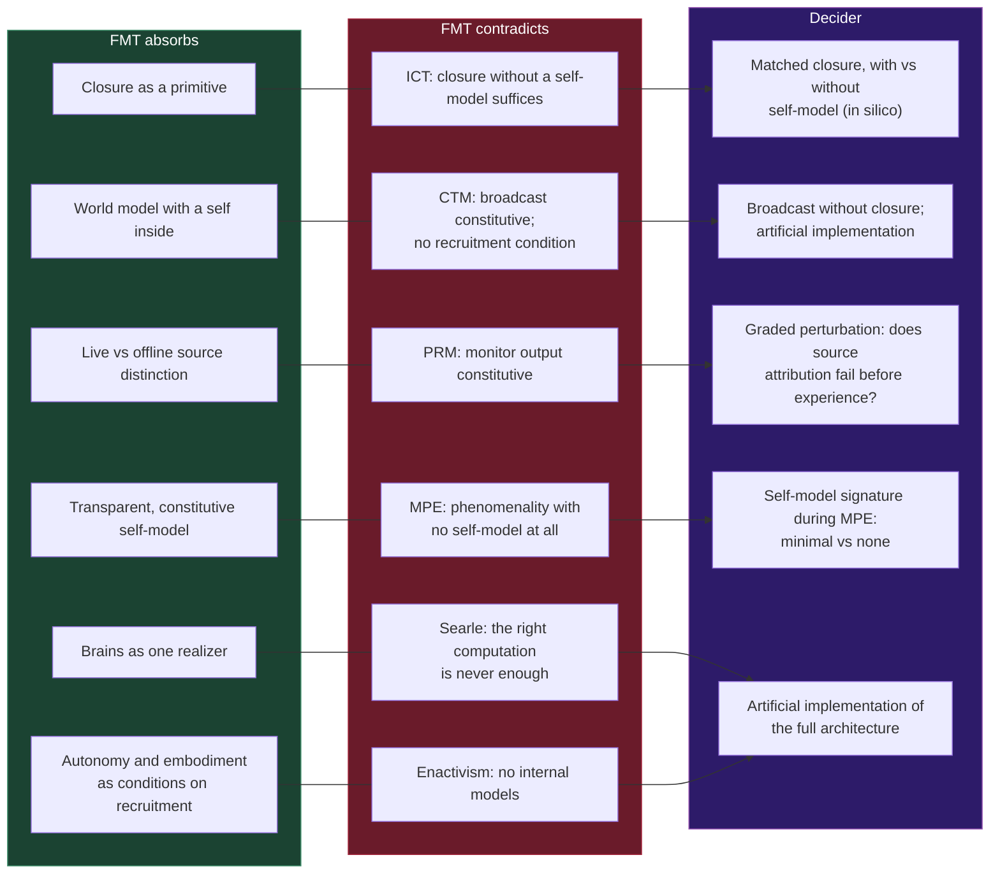

# Further Theories: ICT, CTM, Reality Monitoring, MPE, Searle, Enactivism

**Six further theories each describe something the Four-Model Theory contains: closure, a workspace, reality monitoring, a transparent self-model, the causal powers of brains, embodiment. FMT absorbs that part of each and conflicts with each on one specific claim, and for most of them the experiment that would decide can be stated.**

The one-to-one comparative pages cover IIT, GNW, HOT, PP, AST and RPT. This page treats six further theories in the same form: what FMT absorbs, where the two conflict, and what would decide between them. Where each sits in FMT's architecture is shown on the [theory map](theory-map.md).

## Information Closure and the Conscious Turing Machine

**Information closure theory** (ICT; [Chang, Biehl, Yu & Kanai, 2020](https://doi.org/10.3389/fpsyg.2020.01504)) holds that a process is conscious when it forms non-trivial informational closure with respect to its environment at a coarse-grained scale: its own state predicts its future while it carries information about the environment. FMT absorbs closure as a primitive, and ICT's coarse-grained level corresponds to FMT's computational level. The conflict is over what must close. ICT requires no self-model; on FMT, "closure counts only where the self-model enters the world model's update rule" ([self-referential closure](../core-architecture/self-referential-closure.md)). The decider is in silico: two systems with matched informational closure, one with and one without a self-model in the world model's update loop, compared on redeployment and sample efficiency at a matched budget ([Gruber, 2026d](https://doi.org/10.5281/zenodo.21610993)). It separates the architectures and leaves the phenomenal question open.

The **Conscious Turing Machine** (CTM; [Blum & Blum, 2022](https://doi.org/10.1073/pnas.2115934119)) is a formal model on workspace lines: processors compete for a limited stage, the winning content is broadcast to all processors, and one processor is a Model-of-the-World that contains a model of the machine itself. FMT absorbs that world model with a self inside it, the [ESM](../core-architecture/explicit-self-model.md) nested in the [EWM](../core-architecture/explicit-world-model.md). It contradicts the CTM twice. In the CTM broadcast is constitutive of consciousness; on FMT it is the occupancy of the channel through which content reaches the closed simulation, the same disagreement as with [GNW](vs-gnw.md). And the CTM attributes consciousness to any machine that implements its architecture, with no condition that the machine recruit its own capability for self-modeling. FMT's recruitment condition excludes a heteronomous universal machine, the way it excludes a laptop ([two thresholds](../physical-foundations/two-thresholds.md)). The second conflict needs an artificial implementation to decide; the CTM's AI blueprint ([Yu et al., 2026](https://arxiv.org/abs/2605.04097)) is one candidate.

## Perceptual Reality Monitoring

On **perceptual reality monitoring** (PRM; [Lau, 2022](https://doi.org/10.1093/oso/9780198856771.001.0001)), a sensory representation is experienced when a higher-order monitor marks it as a reliable reflection of the present state of the world. FMT absorbs the monitoring function: the architecture must keep live and offline runs of the explicit models distinguishable, "without which recall would be hallucination". It posits no marker on internally generated states, and it makes closure constitutive of experience where PRM makes the monitor's output constitutive. The theories differ in an ordering. On FMT, source attribution degrades before experience does under perturbation; on PRM, experience follows the monitor's output. Dreaming is the everyday case FMT points to: experience fully present, source attribution absent. A graded perturbation, pharmacological or by sleep stage, that tracks reality judgements and experience reports separately can decide, provided the monitor's output can be read independently of the reality judgement.

## Minimal Phenomenal Experience

Metzinger's programme on **minimal phenomenal experience** (MPE; [Metzinger, 2020](https://doi.org/10.33735/phimisci.2020.I.46)) studies reports, mostly from meditators, of "pure awareness" described as contentless and selfless. FMT absorbs the rest of self-model theory: the self-model is constitutive of experience and transparent to its bearer ([self-modeling tradition](self-modeling-tradition.md)). If phenomenality occurred with no self-model at all, FMT's third principle would be false. FMT's reading is that the floor of consciousness, [minimal consciousness](../mechanisms/minimal-consciousness.md), is itself a rudimentary closure, so a state at the minimum of content and recursion "retains an implicit boundary between self and world, though nothing in it represents a self". Reports of MPE are reconstructions made at the recursive rungs, through memory and language. On this reading "selfless" records the absence of a represented self, which FMT accepts. The decider is a measure of self-model activity independent of the default mode network, recorded during verified MPE episodes: FMT predicts a minimal but non-zero signature, the strict selfless reading none.

## Biological Naturalism and Enactivism

**Biological naturalism** ([Searle, 1980](https://doi.org/10.1017/S0140525X00005756); Searle, 1992) holds that brains cause consciousness by their specific causal powers, that implementing a program is never by itself sufficient for a mind, and that a simulation is not a duplication. Searle allows that a non-biological system with causal powers equivalent to the brain's could be conscious, so his conflict with FMT concerns computation, and biology only as the realizer whose powers would have to be matched. FMT is compatible with brains producing consciousness through their biology, as one realizer among several. It contradicts the claim that the right computation is insufficient: any physical system meeting FMT's sufficient conditions is conscious ([substrate independence](../philosophical/substrate-independence.md)), and running the computation instantiates the process where a description of it does not.

**Enactivism** (Varela, Thompson & Rosch, 1991; Thompson, 2007) holds that mind is embodied sense-making continuous with life, and its strong strands deny that experience is constituted by internal representations of a pre-given world. FMT is compatible with autonomy and embodiment as conditions on how a system comes to recruit its capability for its own modeling. It contradicts the denial of internal models: on FMT experience is a running internal simulation, and [dreaming](../phenomena/sleep.md) runs on internally generated input while sensory input is attenuated and motor output blocked. The enactivist reply appeals to sensorimotor history, and history of that kind is what the implicit models store. The continuity of life and mind conflicts with FMT if the mind it attributes to every living system includes experience, since systems below self-referential closure have none.

Neither dispute has an empirical decider until an artificial implementation of the full architecture exists. For enactivism the decisive case is experience in a system whose models were never trained through sensorimotor coupling.

## Figure

*For each of the six theories, the part FMT absorbs (left), the claim it contradicts (center), and the experiment that would decide (right). Searle's biological naturalism and enactivism share one decider: an artificial system built to the full architecture.*

## Key Takeaway

Each of the six theories names a real part of FMT's architecture. The conflicts are over sufficiency (ICT, CTM, PRM), over whether experience needs a self-model at all (MPE), and over whether internal computation is enough (Searle, enactivism). For ICT, reality monitoring and MPE a decider can be described now, in silico or in brains; the CTM's broadcast claim shares GNW's decider, and the remaining disputes wait for a built system.

## See Also

- [Theory Map: Where the Major Theories Sit in FMT](theory-map.md)
- [FMT vs. Global Neuronal Workspace (GNW)](vs-gnw.md)
- [FMT and the Self-Modeling Tradition](self-modeling-tradition.md)
- [Self-Referential Closure](../core-architecture/self-referential-closure.md)
- [Meditation](../phenomena/meditation.md)
- [Substrate Independence](../philosophical/substrate-independence.md)

---

Based on: Gruber, M. (2026). The Four-Model Theory of Consciousness. Zenodo. https://doi.org/10.5281/zenodo.18669891
