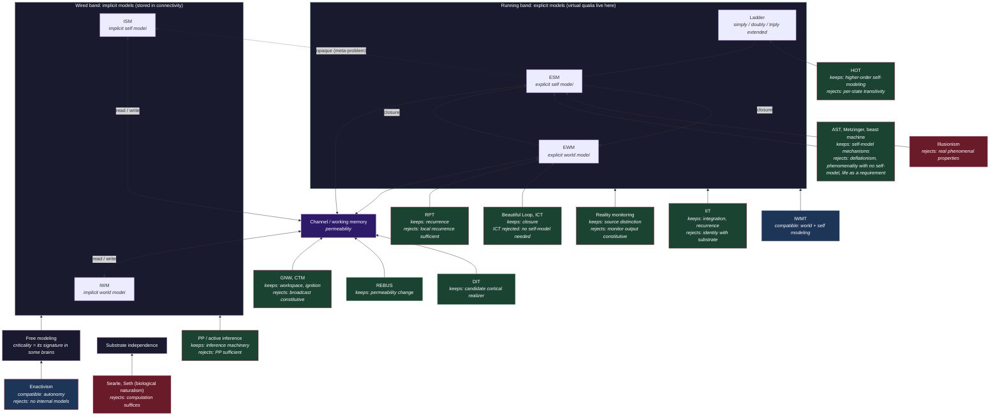

# Theory Map: Where the Major Theories Sit in FMT

**Most theories of consciousness describe one part of the architecture the Four-Model Theory specifies. FMT keeps most of their mechanisms and rejects specific claims about what is sufficient for experience, whether phenomenal properties are real, and whether the right computation is enough without biology.**

The other comparative pages set FMT against one theory at a time, or score theories against the [eight requirements](../foundations/eight-requirements.md). This page places eighteen theories and variants on a single picture of FMT's architecture. Each theory is broken into separate claims, because one theory can be right about a mechanism and wrong about what that mechanism is sufficient for. Each claim gets one of four verdicts:

- **Absorbed** — FMT contains the claim as one of its own components or as an implementation of one.
- **Compatible** — FMT does not contain the claim and nothing in FMT conflicts with it.
- **Neutral** — FMT takes no position.
- **Contradicts** — the claim and FMT cannot both be true.

## The Reference Architecture

FMT's architecture has two kinds of model along two axes: implicit models stored in the substrate's connectivity ([IWM](../core-architecture/implicit-world-model.md), [ISM](../core-architecture/implicit-self-model.md)) and explicit models generated from them as running processes ([EWM](../core-architecture/explicit-world-model.md), [ESM](../core-architecture/explicit-self-model.md)). The self-model is nested inside the world-model. The explicit models read from and write back to the implicit ones along a low-rank channel, whose occupancy is working memory. The theory's third principle is an identity: phenomenology "is that level's modeling closed on itself", the self-model and the world-model each entering the other's update rule. That is [self-referential closure](../core-architecture/self-referential-closure.md). Underneath everything runs **free modeling**, the open-ended (Class 4) computation the system recruits for its own modeling; [criticality](../physical-foundations/criticality.md) is the signature free modeling leaves in some brains, not a requirement.

These components give each theory a place to sit:

- the **wired band** (implicit models, connectivity);
- the **channel** between the bands (workspace, working memory, [permeability](../mechanisms/variable-permeability.md));
- the **running band** (explicit models);
- the **closure loop**;
- the **ladder** of recursive self-modeling depth ([graduated consciousness](../mechanisms/graduated-consciousness.md));
- the **opacity** between self-model and substrate ([meta-problem](../hard-problem/meta-problem.md));
- the **free-modeling field** beneath it all;
- **substrate independence** at the outside edge.

## Figure

*Each theory is attached to the part of FMT its central claim is about. Green boxes: FMT keeps the theory's mechanism. Blue boxes: FMT can live with the theory's main claim. Red boxes: FMT rejects the theory's main claim. A red outline marks a specific claim FMT rejects, named in the box. The implicit models form one wired band and the explicit models one running band; the four labels mark poles of one modeling space, not four modules.*

## The Summary Table

| Theory | Where it sits in FMT | FMT keeps | FMT rejects | Page |
|---|---|---|---|---|
| IIT (Tononi; Albantakis et al.) | Running band, closure, free modeling | Consciousness is irreducible, integrated, causally structured; recurrence | Identity with the substrate's cause-effect power; every Φ > 0 system conscious | [vs-iit](vs-iit.md) |
| GNW (Baars; Dehaene & Changeux) | Channel | Workspace = channel occupancy; capacity limit; ignition as marker | Broadcast as what makes content conscious | [vs-gnw](vs-gnw.md) |
| CTM (Blum & Blum) | Channel; world model containing a self | World model with a self inside it | Broadcast constitutive; no recruitment condition | [further theories](further-theories.md) |
| Predictive processing (Friston; Hohwy & Seth) | Wired band; generation of explicit models | Prediction-error machinery as the implicit layer's implementation | PP as sufficient for consciousness | [vs-pp](vs-pp.md) |
| Beast machine (Seth) | ISM → ESM | Interoceptive inference as one route to the self-model | Life as a possible requirement | [self-modeling tradition](self-modeling-tradition.md) |
| REBUS (Carhart-Harris & Friston) | Permeability | One implementation of global permeability change | — | [vs-pp](vs-pp.md) |
| Beautiful Loop (Laukkonen, Friston & Chandaria) | Closure | Self-evidencing loop = closure | — | — |
| HOT (Rosenthal; Lau & Rosenthal) | Ladder | Higher-order self-modeling as the extended rungs | A higher-order representation of the particular state, rather than closure of the whole system, as the condition of experience | [vs-hot](vs-hot.md) |
| Perceptual reality monitoring (Lau) | Source distinction | Reality monitoring as a function | Monitor output as what makes experience | [further theories](further-theories.md) |
| RPT (Lamme) | Generation of the running models | Recurrence as the mechanism | Local sensory recurrence as sufficient | [vs-rpt](vs-rpt.md) |
| AST (Graziano) | Self-model; attention into the channel | Attention schema as part of the self-model; meta-problem mechanism | That the experience depicted in claims of awareness does not exist ("small" illusionism) | [vs-ast](vs-ast.md) |
| Self-model theory (Metzinger) | Self-model | Self-model as constitutive; transparency; "selfless" minimal phenomenal experience read as no represented self | Phenomenality with no self-model at all | [further theories](further-theories.md) |
| IWMT (Safron) | Running band; free modeling | World and self modeling; near-critical signature; formal mechanism | Graded demarcation (mild) | — |
| DIT (Aru, Suzuki & Larkum) | Step from wired to running band | Candidate cortical realizer | — (uniqueness: neutral) | — |
| ICT (Chang, Biehl, Yu & Kanai) | Closure | Closure as the primitive | Informational closure without a self-model as sufficient | [further theories](further-theories.md) |
| Illusionism (Dennett; Frankish) | Substrate side; meta-problem | No phenomenal properties in the substrate | No phenomenal properties at any level | [two-level ontology](../hard-problem/two-level-ontology.md) |
| Biological naturalism (Searle; Seth) | Substrate independence | Interoceptive self-regulation as one route | Searle: the right computation is never enough. Seth: consciousness may depend on being alive | [further theories](further-theories.md) |
| Enactivism (Varela, Thompson & Rosch; Thompson) | Free-modeling recruitment | Autonomy and embodiment as conditions on recruitment | Experience without internal models; experience in every living system, if "mind" there includes it | [further theories](further-theories.md) |

## What the Pattern Shows

**Mechanisms are kept.** The global workspace becomes the channel and its occupancy. Recurrent processing becomes the dynamics that host the running models. Prediction-error minimization becomes the machinery of the implicit layer. Higher-order self-representation becomes the rungs of the ladder. Apical dendritic coupling in layer-5 neurons becomes a candidate cortical realizer of the step from stored to running models. The attention schema becomes part of the self-model. The Beautiful Loop and information closure theory both name closure.

**Sufficiency claims are rejected.** Each of these theories also says what is enough for experience: broadcast (GNW), local recurrence (RPT), a higher-order representation of the state (HOT), informational closure without a self-model (ICT), any integrated structure with Φ above zero (IIT). FMT's answer to all of them is the same: phenomenality is the self-model and world-model closed on each other, so none of these structures is enough without that closure.

**Ontology and substrate claims are rejected.** Illusionism denies that phenomenal properties exist, and AST that the experience our claims of awareness describe exists; on FMT they exist at the computational level as [virtual qualia](../hard-problem/virtual-qualia.md). Searle holds that running the right computation is never enough, and Seth that consciousness may depend on being alive. FMT holds that any physical system meeting its [sufficient conditions](../physical-foundations/two-thresholds.md) is conscious: the four models under closure, free compute, embodiment, and at least one pain-pleasure axis. Strong enactivism denies that experience is made of internal models; on FMT experience is a running internal simulation.

## Which Disagreements Can Be Tested

Each rejection comes with the experiment that would decide it, where one exists.

- **GNW:** make content globally available without letting it into the self-model's update rule. No such manipulation exists yet in brains. Language models show the half that exists: a broadcast workspace without closure.
- **RPT:** find a state with local sensory recurrence intact and self-model dynamics abolished. RPT predicts experience, FMT none. "Islands of awareness" are the candidate case, but they cannot report.
- **HOT:** abolish metacognitive read-out while sparing first-order perception and the self-model loop. HOT predicts experience changes; FMT predicts it survives. HOT proponents need not accept that metacognitive measures track the higher-order representation their theory requires.
- **Reality monitoring:** perturb the brain and track reality judgements and experience separately. FMT predicts source attribution fails first, as in dreaming.
- **IIT:** no decider in brains yet. The unfolding argument targets both theories; FMT's reply is that a closed system and its unfolded feedforward twin stop agreeing on behavior once a resource bound applies, a difference measurable in silico ([vs-iit](vs-iit.md)).
- **ICT, IWMT:** build matched artificial systems with and without a self-model in the loop. This separates the architectures in silico, though behavior does not settle experience.
- **Minimal phenomenal experience:** record a measure of self-model activity during verified episodes. FMT predicts a minimal but non-zero signature; the strict selfless reading predicts none.
- **Biological naturalism, enactivism:** decidable only with an artificial system that implements the full architecture, which does not yet exist.
- **AST and illusionism:** no empirical test exists. Both sides explain the reports. The difference is ethical: on FMT, an artificial system that meets the sufficient conditions would have phenomenal states and be a moral patient for that reason.

Any experiment that tries to remove closure meets one complication. In a recurrent network, cutting one loop tends to leave two smaller closed systems. A manipulation has to show that it removed closure, not just that it opened a loop.

## Key Takeaway

FMT contains most of these theories' mechanisms as components. Its disagreements with them concern what is enough for experience and whether experience is real, and several can be decided by experiments that can be described now.

## See Also

- [Comparative Scoreboard](scoreboard.md)
- [Further Theories: ICT, CTM, PRM, MPE, Searle, Enactivism](further-theories.md)
- [FMT vs. Integrated Information Theory (IIT)](vs-iit.md)
- [FMT vs. Global Neuronal Workspace (GNW)](vs-gnw.md)
- [FMT vs. Predictive Processing (PP)](vs-pp.md)
- [FMT vs. Higher-Order Theories (HOT)](vs-hot.md)
- [FMT vs. Recurrent Processing Theory (RPT)](vs-rpt.md)
- [FMT vs. Attention Schema Theory (AST)](vs-ast.md)
- [FMT and the Self-Modeling Tradition](self-modeling-tradition.md)
- [COGITATE and Adversarial Collaborations](cogitate.md)
- [Self-Referential Closure](../core-architecture/self-referential-closure.md)
- [Two Thresholds for Consciousness](../physical-foundations/two-thresholds.md)

---

Based on: Gruber, M. (2026). The Four-Model Theory of Consciousness. Zenodo. https://doi.org/10.5281/zenodo.18669891
