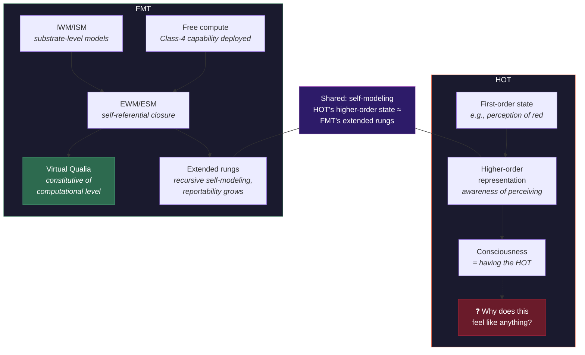

# FMT vs. Higher-Order Theories (HOT)

**FMT and HOT share an emphasis on self-modeling, and HOT's higher-order representation corresponds to the extended, recursive rungs of FMT's ladder. HOT makes a higher-order representation of the particular state the condition of experience; FMT makes closure of the self-simulation the condition, and finds experience already at a minimal level without reflection.**

Higher-Order Theories (Rosenthal, 2005; Lau & Rosenthal, 2011) propose that a mental state becomes conscious when it is the target of a higher-order representation -- roughly, when the system represents itself as being in that state. A perception of red becomes a *conscious* perception of red when there is a higher-order thought about that perception. The higher-order representation is normally itself unconscious; introspection is the case where it becomes conscious. The [Four-Model Theory](../core-architecture/four-model-theory.md) shares the emphasis on self-modeling and assigns higher-order representation a different place.

## The Shared Insight

Both HOT and FMT place **self-modeling** at the center of consciousness. For HOT, a state without a higher-order representation is not conscious, even if it influences behavior. For FMT, consciousness requires the [Explicit Self Model](../core-architecture/explicit-self-model.md), the system's ongoing model of itself, closed with the explicit world model. At the minimal level the self-model is rudimentary: a phenomenal now, at its most primitive a primordial pain or a nothingness, with no reflection and no awareness that it experiences. No per-state higher-order representation is needed.

Conscious states vary on two axes, richness of content and depth of recursion. FMT's [graduated levels](../mechanisms/graduated-consciousness.md) climb the second: simply extended consciousness adds first-order self-observation (awareness that one experiences), doubly extended adds metacognition, triply extended adds reflection on the modeling itself. Reportability grows with recursion depth; minimal content, with no recursion above it, cannot be reported. HOT's higher-order representation, and the Lockean idea of an awareness of being aware that Rosenthal formalized, correspond to these extended rungs.

## Where HOT Stops

HOT explains which states are conscious (those with higher-order representations) and partially addresses the [Meta-Problem](../hard-problem/meta-problem.md): consciousness seems mysterious because higher-order representations are imperfect models of first-order states. It does not explain *why* higher-order representation produces phenomenality.

A thermostat with a second sensor monitoring the first has a "higher-order representation" of room temperature, and nobody concludes it is conscious. HOT theorists reply that the higher-order representation must be of the right kind, a conceptual, assertoric representation in the right functional role. Specifying the "right kind" without circularity is the open task.

HOT also leaves several of the [eight requirements](../foundations/eight-requirements.md) unaddressed. It has no account of [binding](../foundations/eight-requirements.md), its boundary-setting is imprecise, and the [Hard Problem](../hard-problem/dissolution.md) remains: why does a higher-order representation *feel like* anything?

## What FMT Adds

FMT adds three elements that HOT lacks:

1. **The four-model architecture.** HOT posits higher-order representations without specifying the minimal architecture required. FMT specifies it: four model kinds along [two axes](../core-architecture/two-axes.md) (scope and mode), with the ESM as the locus of self-modeling, higher-order on the extended rungs.

2. **Virtual qualia.** FMT explains *why* self-representation produces phenomenality through the [virtual qualia](../hard-problem/virtual-qualia.md) framework: qualia are constitutive properties of the computational level, arising when [self-referential closure](../core-architecture/self-referential-closure.md) collapses the inside/outside distinction. On FMT's account, a self-model is necessary, in rudimentary form at the minimal level; what turns it into phenomenality is closure in the open-ended Class 4 regime, a step the theory argues for rather than derives.

3. **The free-compute requirement.** HOT does not specify what kind of substrate supports consciousness-producing higher-order representation. FMT adds it: the substrate must have Class-4 (universal-computation) capability and actually deploy it, autonomously and open-endedly, for self-modeling. Near-[criticality](../physical-foundations/criticality.md) -- the edge of chaos -- is the signature this leaves in neural tissue and the quantity measured there. This explains why not every system with higher-order representations is conscious -- the substrate must also meet the computational requirement.

## A Concrete Difference

Abolish metacognitive read-out (meta-d′/d′ near zero) while sparing first-order sensitivity, and measure experience with a no-report or criterion-fixed design. HOT predicts that experience is lost or altered. FMT predicts that it survives if the loop between self-model and world-model is intact, because metacognitive report is one read-out of the self-model. Report may still fail, since memory transfer can fail with it. HOT proponents need not accept meta-d′ as a measure of the higher-order representation they require, so the experiment must show what a manipulation removes.

Metacognitive disruption alone therefore does not test closure. FMT's closure claim would fail if disrupting the self-modeling loop itself left no-report markers of experience intact. Conversely, a higher-order representation in a system without closure, such as a monitor attached to a simulation it takes no part in, is not conscious on FMT.

## Figure

*HOT's higher-order representation corresponds to FMT's extended rungs. On FMT, phenomenality arises earlier, from the closure of a rudimentary self-model with the world model.*

## Key Takeaway

HOT places self-modeling at the center of consciousness. FMT puts HOT's higher-order representation on the extended rungs and holds that minimal consciousness is phenomenal without it, adding the architecture, virtual qualia, and free compute (whose neural signature is near-criticality). The testable split: does experience survive the loss of higher-order representation while closure is intact?

## See Also

- [Comparative Scoreboard](scoreboard.md)
- [Graduated Levels of Consciousness](../mechanisms/graduated-consciousness.md)
- [Virtual Qualia](../hard-problem/virtual-qualia.md)
- [The Meta-Problem: FMT's Account](../hard-problem/meta-problem.md)
- [Self-Referential Closure](../core-architecture/self-referential-closure.md)
- [FMT vs. Attention Schema Theory (AST)](vs-ast.md)

---

Based on: Gruber, M. (2026). The Four-Model Theory of Consciousness. Zenodo. https://doi.org/10.5281/zenodo.18669891
