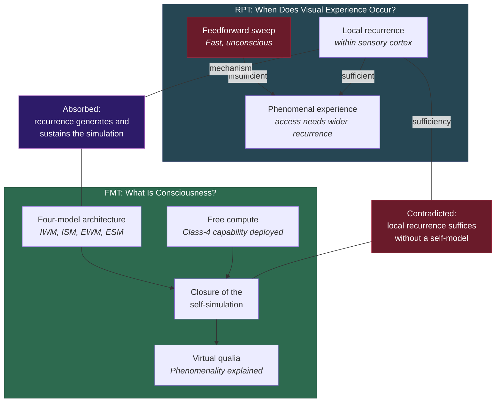

# FMT vs. Recurrent Processing Theory (RPT)

**FMT takes over recurrence as the mechanism that generates and sustains the explicit models, and conflicts with RPT on sufficiency. RPT holds that local recurrence within sensory cortex suffices for phenomenal experience; FMT holds that experience requires the closure of the self-simulation.**

Recurrent Processing Theory (Lamme, 2006, 2010) divides visual processing into stages. The initial feedforward sweep extracts features without producing experience. In stage 3, local recurrence between higher and lower areas within sensory cortex produces phenomenal experience, even when the content is unattended and never reported. In stage 4, widespread recurrence that recruits fronto-parietal areas adds access: the content becomes available for report, reasoning and memory. RPT's strength is its empirical specificity: visual masking paradigms have provided strong support for the claim that feedforward processing alone is insufficient for consciousness. The [Four-Model Theory](../core-architecture/four-model-theory.md) shares RPT's mechanism and disputes its stage-3 claim.

## RPT's Strengths

**Empirical precision.** RPT's predictions are unusually specific and testable. The theory predicts that visual stimuli processed only feedforward (masked before recurrent processing can begin) will not be consciously perceived, even if they influence behavior (priming effects). This has been robustly confirmed across dozens of visual masking studies. RPT is one of the most empirically productive theories in consciousness science.

**Causal role.** RPT provides a clear account of the causal role of consciousness: recurrent processing enables the flexible integration and report of sensory information that feedforward processing cannot achieve.

**Mechanistic clarity.** RPT specifies a concrete neural mechanism, feedback loops between cortical areas, which makes it directly testable with standard neuroscience tools (TMS, EEG, masking paradigms).

## The Scope Difference

RPT addresses **when visual experience occurs**: experience of a visual stimulus begins with local recurrent processing, and access follows when that recurrence spreads. This is a claim about the neural conditions of experience and report.

FMT addresses **what consciousness is**: an ongoing self-simulation across four model kinds in the open-ended Class 4 regime, in which phenomenality is constituted by virtual qualia at the computational level. This is a claim about the nature and architecture of consciousness as such.

Recurrent processing between cortical areas is plausibly also the neural mechanism by which the [implicit-explicit boundary](../mechanisms/implicit-explicit-boundary.md) operates: implicit content enters the running simulation when feedback loops integrate it.

## What RPT Does Not Address

RPT is silent on several requirements that FMT addresses:

- **The [Hard Problem](../hard-problem/dissolution.md).** RPT explains when processing becomes conscious but not *why* recurrent processing produces phenomenality while feedforward processing does not.

- **The self.** RPT focuses on visual consciousness and does not extend to self-awareness, the [Explicit Self Model](../core-architecture/explicit-self-model.md), ego dissolution, or the architectural requirements for a unified conscious self. FMT's four-model architecture addresses this directly.

- **The [Boundary Problem](../foundations/eight-requirements.md).** RPT defines consciousness locally (stimulus-by-stimulus, based on recurrent processing), but does not provide a principled account of where the conscious system as a whole begins and ends.

- **Non-visual consciousness.** RPT was developed for visual consciousness and does not straightforwardly extend to auditory, somatosensory, emotional, or self-referential experience. FMT's architecture is modality-independent.

## Mechanism Absorbed, Sufficiency Contradicted

**The mechanism.** Recurrent processing likely implements the ongoing simulation: feedback loops between cortical areas generate and sustain the [explicit models](../core-architecture/explicit-world-model.md). RPT's masking results therefore support FMT's implementation-level claim that the explicit models require recurrent dynamics.

**The sufficiency claim.** FMT's third principle is an identity, not a law connecting two things: phenomenology "is that level's modeling closed on itself", the self-model and the world-model each entering the other's update rule. A locally recurrent sensory loop with no self-model in its update rule is a simulation without an inside, like the weather simulation and the monitored simulation in the [closure argument](../core-architecture/self-referential-closure.md). The cases RPT cites for experience beyond access, such as the fragile high-capacity visual store (Sligte et al., 2008), FMT reads as a thin self-model running below threshold, with too little recursion above it for its content to be reported.

**The decider.** The test is a state in which local sensory recurrence is preserved while the self-model loop is disrupted or absent, with experience assessed through no-report markers. Candidates are isolated or disconnected cortical tissue of the kind discussed as islands of awareness (Bayne et al., 2020), anaesthetic or dissociative states that preserve figure-ground modulation, and in-silico ablations. RPT predicts experience; FMT predicts none. No clean protocol exists in brains yet: cutting one loop can leave two closed subsystems, so a manipulation must show that it removed closure.

The [free-compute requirement](../physical-foundations/criticality.md) adds a constraint that RPT does not consider: the recurrent processing must occur in a substrate with Class-4 (universal-computation) capability actually deployed for open-ended self-modeling -- the condition whose signature in neural tissue is near-criticality, the edge of chaos -- not merely in any recurrent network.

## Figure

*FMT absorbs RPT's mechanism: recurrent processing plausibly implements the ongoing simulation. It contradicts RPT's sufficiency claim: on FMT, local sensory recurrence without a self-model in the loop produces no experience, because phenomenality is the closure of the self-simulation.*

## Key Takeaway

RPT supplies the mechanism FMT needs: recurrent dynamics generate and sustain the explicit models. The theories conflict over local recurrence in sensory cortex. RPT counts it as phenomenal experience; FMT counts it as a simulation without an inside unless the self-model closes the loop. Preserving local recurrence while disrupting the self-model loop, scored with no-report markers, would decide between them.

## See Also

- [Comparative Scoreboard](scoreboard.md)
- [The Implicit-Explicit Boundary](../mechanisms/implicit-explicit-boundary.md)
- [Criticality: Signature, Not Requirement](../physical-foundations/criticality.md)
- [How FMT Answers the Hard Problem](../hard-problem/dissolution.md)
- [FMT vs. Global Neuronal Workspace (GNW)](vs-gnw.md)
- [Theory Map: Where the Major Theories Sit in FMT](theory-map.md)

---

Based on: Gruber, M. (2026). The Four-Model Theory of Consciousness. Zenodo. https://doi.org/10.5281/zenodo.18669891
