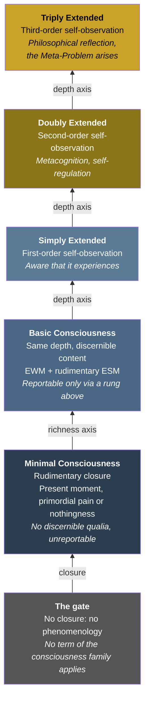

# Graduated Levels of Consciousness

**A system has phenomenology or it has none; above that single gate, consciousness is graduated along two independent axes, richness of content and depth of recursion.**

The question "Is this system conscious?" has a yes/no answer in the Four-Model Theory, and the answer is only the start. Since [phenomenality is closure](../core-architecture/self-referential-closure.md), "a system has phenomenology or it has none, and without it no term of the consciousness family (consciousness, awareness, sentience, self-awareness) applies." Above that gate the theory grades consciousness "along two axes: richness of content, the bandwidth the explicit models carry at a given level, and depth of recursion, the number of layers of self-modeling above the basic self-model." A bacterium is below the gate. A fish is a candidate for the floor. A human philosopher asking "What is consciousness?" is at least three rungs of recursion above it.

## The Two Level Axes

The two axes vary independently. Richness is how much the [Explicit World Model](../core-architecture/explicit-world-model.md) and [Explicit Self Model](../core-architecture/explicit-self-model.md) carry; depth is how many layers of self-modeling sit above the basic self-model. The master paper's example separates them: "a non-lucid dream can be rich in content at a shallow depth of recursion." A drowsy driver is shallow and thin; a philosopher reading in a quiet room is deep and moderately rich.

These are the *level axes*. They are unrelated to the [two axes of scope and mode](../core-architecture/two-axes.md), which classify the four model kinds rather than grade consciousness.

## The Levels

### Minimal Consciousness (the floor)

"A rudimentary closure, consciousness at its minimum. The explicit world and self models close on each other, and their content is the present moment together with a primordial pain or a nothingness. There is no reflection, no modeled past or future, and no discernible qualia." Minimal consciousness is the floor of both axes, and it is unreportable by definition. It has its own article: [Minimal Consciousness](minimal-consciousness.md).

### Basic Consciousness

"Non-recursive self-simulation with discernible content." The system generates an EWM and a rudimentary ESM and experiences a world with discernible qualities from a subject's position. Basic consciousness "lies above minimal consciousness on the content axis and at the same depth of recursion: the self-model is in the loop but does not take itself as an object, so self-awareness is thin. Its content becomes reportable only where a recursive rung above it takes that content as an object." Rodents support at least this level.

### Simply Extended Consciousness

First-order self-observation. The ESM includes a model of the system's own states and processes, so the organism not only experiences but is *aware that it experiences*. Mammals with mirror self-recognition (great apes, elephants, dolphins) likely operate at this level.

### Doubly Extended Consciousness

Second-order self-observation — metacognition. The system models itself modeling itself. "I realize I'm not paying attention" requires a model of the system modeling its own attentional states. This level supports strategic thinking, self-regulation and deliberate cognitive control.

### Triply Extended Consciousness

Third-order self-observation: the system models itself modeling itself modeling itself. This supports philosophical reflection and the capacity to ask "What is consciousness?" as a question about one's own experience. It is also where the [Meta-Problem](../hard-problem/meta-problem.md) arises: only a system that models its own modeling of its own experience can notice that consciousness *seems* mysterious. "A system without that depth can emit the sentence but has nothing for it to be about."

## Points on a Continuum

Above the gate, the levels "are not discrete stages but points along a continuum."

- **Organisms fluctuate between levels.** A human operates at triply extended consciousness during philosophical discussion and may drop to basic consciousness during drowsy, automatic driving. Sleep, intoxication and fatigue shift the system's position on both axes.
- **Different species occupy different ranges.** The question "Is a dog conscious?" becomes "How deeply, and how richly, does a dog self-model?" — a question with potentially empirical answers. See [Animal Consciousness](../phenomena/animal-consciousness.md).
- **Each rung above basic adds a layer of recursive self-modeling.** Recursion converts presence into reportability: content can be present, and phenomenal, at the lower levels without the system being able to take it as an object.

## Implications for Artificial Systems

A system need not reach triply extended consciousness to be conscious at all: minimal consciousness is already phenomenal. Current AI systems, including large language models, are below the gate on this framework. Post-trained language models carry a reportable self-representation, but without closure over it, without persistence, and outside the Class 4 regime whose neural signature is [criticality](../physical-foundations/criticality.md). An artificial system that met the [sufficient conditions](../physical-foundations/two-thresholds.md) would first enter at the floor and reach the higher rungs only with added recursive depth.

## Figure

*One gate and five levels. Closure is the gate. Minimal and basic consciousness share the same depth of recursion and differ in content; each rung above basic adds a layer of self-modeling. Richness of content also varies independently at every rung, which a single ladder cannot draw.*

## Key Takeaway

Consciousness has one gate and two axes. Without closure there is no phenomenology and no term of the consciousness family applies; above the gate, consciousness is graded by richness of content and depth of recursion, from minimal consciousness at the floor to triply extended consciousness, where the intuition that consciousness is mysterious arises.

## See Also

- [Minimal Consciousness](minimal-consciousness.md)
- [Self-Referential Closure](../core-architecture/self-referential-closure.md)
- [Explicit Self Model (ESM)](../core-architecture/explicit-self-model.md)
- [The Meta-Problem: FMT's Account](../hard-problem/meta-problem.md)
- [Animal Consciousness](../phenomena/animal-consciousness.md)
- [Two Thresholds for Consciousness](../physical-foundations/two-thresholds.md)

---

Based on: Gruber, M. (2026). The Four-Model Theory of Consciousness. Zenodo. https://doi.org/10.5281/zenodo.18669891
