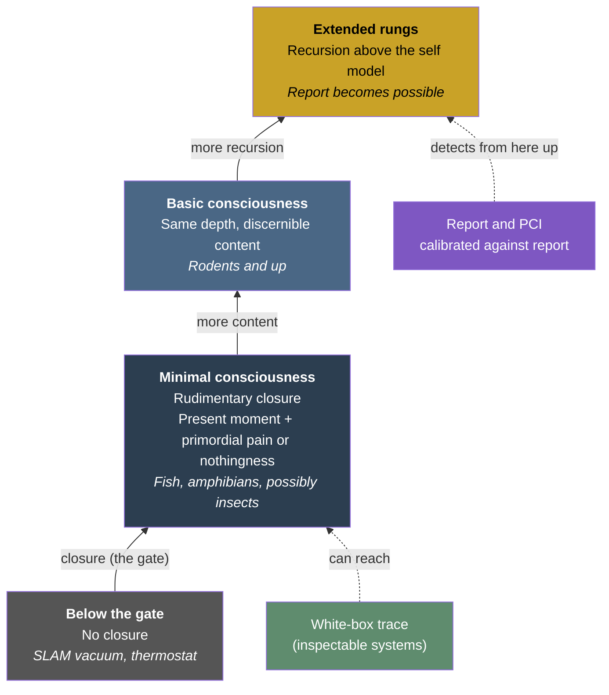

# Minimal Consciousness

**Minimal consciousness is the floor of consciousness in the Four-Model Theory: a rudimentary closure of the explicit world and self models, whose content is the present moment together with a primordial pain or a nothingness.**

The theory has one gate. "A system has phenomenology or it has none, and without it no term of the consciousness family (consciousness, awareness, sentience, self-awareness) applies." Minimal consciousness is what lies directly above the gate: the lowest point on both [level axes](graduated-consciousness.md), richness of content and depth of recursion. It matters because it fixes where the theory draws the boundary between experience and its absence, and it puts that boundary below anything a subject can report.

## What the Floor Contains

The master paper defines it as "a rudimentary closure, consciousness at its minimum. The explicit world and self models close on each other, and their content is the present moment together with a primordial pain or a nothingness. There is no reflection, no modeled past or future, and no discernible qualia."

The closure is real, so there is an inside: something it is like to be the system, however little. What is missing is everything that would let the system do anything with that inside. "With no recursion above it and no discernible content to take as an object, minimal consciousness is unreportable by definition." Reporting requires taking content as an object, holding it in memory and putting it into words, and each of those needs [self-modeling above the content](graduated-consciousness.md).

The self model at the floor is still a self model. It is "a model of the system itself, however simple"; "a mutual update between a position estimate and a map does not qualify." A robot vacuum running SLAM updates a map from its position and its position from the map, and stays below the gate: its "self" is a single datum, and it has no implicit/explicit split and no [free compute](../physical-foundations/criticality.md) recruited for its own modeling.

## The Floor and Basic Consciousness

[Basic consciousness](graduated-consciousness.md) sits "above minimal consciousness on the content axis and at the same depth of recursion." Both levels run a self model that is in the loop without taking itself as an object. The difference is content: the basic level experiences a world with discernible qualities from a subject's position, while the floor has the present moment and a pain or a nothingness. Neither reports on its own; basic content "becomes reportable only where a recursive rung above it takes that content as an object."

## Terminology

The English label is *minimal consciousness*. Three neighboring terms are kept apart from it.

- **Sentience.** "Where the animal-welfare literature speaks of sentience, the capacity for felt, valenced states, minimal consciousness is its closest counterpart." The correspondence is a cross-reference to that literature, not a second name for the floor.
- **Awareness.** The theory does not use *awareness* for the floor, "because in Gruber (2015), as in Chalmers (1996a), awareness denotes content-directed access."
- **The clinical minimally conscious state.** "The term is unrelated to the clinical minimally conscious state," the diagnostic category for patients with disorders of consciousness. Minimal consciousness "lies below what report, and PCI as calibrated against report, can detect."

## Candidates and Edge Cases

**Animals.** "The theory's candidates for this level are fish, amphibians, and possibly insects." For insects the condition is closure itself: "An insect brain that sustains even a rudimentary closure has at least minimal consciousness." See [Animal Consciousness](../phenomena/animal-consciousness.md).

**Locked in from birth.** The [sufficient conditions](../physical-foundations/two-thresholds.md) include embodiment, because "the body is what gives the self model its content." A person locked in from birth "would have little discernible content for the self model and would sit near the floor of minimal consciousness: at or slightly below it, or slightly above it where priors and an intact, rich sensory system still supply content."

**Evidence without report.** Since the floor cannot report, behavioral analysis is all that is available for a system that cannot be inspected. Where the connectome, the weights and the running system can be inspected, the [white-box trace](../predictions/white-box-trace.md) applies: the non-report signature of minimal consciousness is "a signal traced to the closed self and world models."

## Figure

*Minimal consciousness sits directly above the gate. Report and report-calibrated markers detect consciousness only where recursion above the content makes report possible; at the floor, only an inspection of the running system can show the closed loop.*

## Key Takeaway

Minimal consciousness is consciousness at its minimum: a closed loop of world and self models holding the present moment and a pain or a nothingness, with no reflection, no past or future and no discernible qualia. It is phenomenal and unreportable by definition, so report-based methods cannot find it.

## See Also

- [Graduated Levels of Consciousness](graduated-consciousness.md)
- [Self-Referential Closure](../core-architecture/self-referential-closure.md)
- [Animal Consciousness](../phenomena/animal-consciousness.md)
- [Two Thresholds for Consciousness](../physical-foundations/two-thresholds.md)
- [Deciding Consciousness Without Report: The White-Box Trace](../predictions/white-box-trace.md)
- [Minimum Configuration for Consciousness](../open-questions/minimum-configuration.md)

---

Based on: Gruber, M. (2026). The Four-Model Theory of Consciousness. Zenodo. https://doi.org/10.5281/zenodo.18669891
