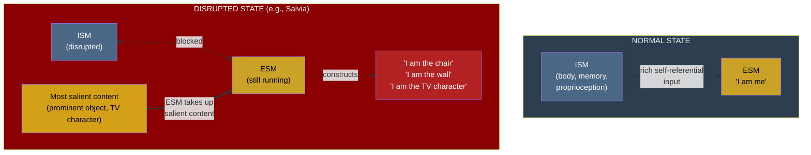

# The Redirectable ESM

**The Explicit Self Model requires input. Disrupt its normal self-referential feed and it does not shut down — it takes up the most salient content available, producing radical identity alteration including the experience of "becoming" non-self entities.**

The [ESM](../core-architecture/explicit-self-model.md) is not a static data structure. It is a continuously running process that constructs the conscious self from available input — normally, self-referential signals from the [ISM](../core-architecture/implicit-self-model.md) (body schema, proprioception, interoception, autobiographical memory). But "normally" is a key qualifier. When this self-referential input stream is disrupted, the ESM does not cease to exist. It continues to run, and it needs input. Deprived of its usual feed, it redirects to the content most prominent in the explicit world-model at that moment.

This redirectability is a consequence of the theory's three principles, not a fourth: the self-model that closes the modeling loop is a generated process dependent on input, so when its normal input is disrupted it takes up other content. It generates testable predictions about what that content will be.

## The Mechanism

In normal waking states, the ESM receives a rich stream of self-referential input: proprioceptive data from the body, interoceptive signals from the viscera, motor-efference copies from the action system, and autobiographical context from the ISM. These inputs constrain the ESM's output to produce the familiar sense of being *you* — a specific person, in a specific body, with a specific history.

When this input is disrupted — by pharmacological action, neurological damage, or extreme physiological states — the ESM's self-construction process is starved. But the process itself continues. Like a radio receiver that has lost its station, the ESM takes up whatever is most prominent and locks onto it. The result is that the ESM constructs a self from the most salient remaining content, which may have nothing to do with the organism's actual identity or body.

## Salvia Divinorum: The Clearest Illustration

The phenomenology of **salvia divinorum** (salvinorin A, a κ-opioid agonist; [Roth et al., 2002](https://doi.org/10.1073/pnas.182234399)) is consistent with ESM redirectability. In a literature of user and case reports rather than controlled studies, salvia users report experiences of "becoming" objects or entities in their immediate environment:

- Becoming a piece of furniture in the room
- Becoming a wall or floor surface
- Becoming a character from a television show playing nearby
- Becoming a geometric pattern perceived in the visual field

The Four-Model Theory accounts for this pattern. The ESM, deprived of normal self-input, takes up the most salient content in the scene — a prominent object in the room, the character a television show is displaying. A television character carries no contingency with the viewer's heartbeat, breathing or movement. On this account the identity experience should track salient content in an input-dependent and dose-dependent, and therefore *testable*, manner.

## Ego Dissolution: Not Abolition but Redirection

The standard account of ego dissolution under psychedelics treats it as the *loss* of self. The Four-Model Theory reframes it: ego dissolution is not the abolition of the ESM but its **redirection**. The ESM continues to run — the subject still has experience, still has a perspective — but the content of that experience shifts from "I am me" to "I am the universe" or "I am this pattern" or "I am nothing," depending on what input remains available.

This reframing generates a testable prediction: the *content* of ego dissolution should be controllable. If the ESM takes up the most salient content, then controlling what is salient during ego dissolution should control what the subject "becomes." This is [Prediction 2](../predictions/prediction-2-ego-dissolution.md), stated for salvinorin A at doses below the range where external input is gated ([Maqueda et al., 2015](https://doi.org/10.1093/ijnp/pyv065)); whether classic serotonergic psychedelics produce the same migration onto external objects is open. IIT, GNW, HOT and AST have no mechanism for specifying what a subject will "become". Predictive processing has one, and input tracking as such is shared with it: with self-priors relaxed ([Carhart-Harris & Friston, 2019](https://doi.org/10.1124/pr.118.017160)), the most precise channel sets belief about the self. The accounts part where salience and bodily contingency come apart. Predictive accounts of bodily self-attribution weight heartbeat-synchronised signals ([Suzuki et al., 2013](https://doi.org/10.1016/j.neuropsychologia.2013.08.014); [Aspell et al., 2013](https://doi.org/10.1177/0956797613498395)), while the redirectable ESM follows the salient stream regardless of synchrony.

## Clinical Manifestations

ESM redirectability is not confined to psychedelic experiences. The same mechanism appears in clinical contexts:

- **Cotard's delusion** — patients report believing they are dead or that their organs have disappeared. The ESM receives severely distorted interoceptive input due to neurological damage. Deprived of normal embodied signals, it constructs the best model it can from the available (distorted) input — and "I am dead" is the ESM's interpretation of absent or contradictory body signals. This is the same mechanism that produces "I am a chair" under salvia, operating on clinical rather than pharmacological input.
- **Depersonalization/derealization** — the ESM receives attenuated self-referential input, producing the sense that the self or the world is unreal, distant, or dreamlike. The ESM is running but receiving weak signal — the self-model is generated but thin, producing the characteristic feeling of watching oneself from outside.

## Figure

## Key Takeaway

The ESM is an input-hungry process, not a fixed identity module. When normal self-referential input is disrupted, it does not disappear — it redirects, constructing a self from the most salient content available. This single mechanism unifies salvia "becoming" experiences, psychedelic ego dissolution, Cotard's delusion, and depersonalization under one explanatory principle. It also generates a testable prediction: that the content of ego dissolution is controllable by controlling what is salient.

## See Also

- [Explicit Self Model (ESM)](../core-architecture/explicit-self-model.md)
- [The Real/Virtual Split](../core-architecture/real-virtual-split.md)
- [Ego Dissolution](../phenomena/ego-dissolution.md)
- [Prediction 2: Ego Dissolution Content Is Controllable](../predictions/prediction-2-ego-dissolution.md)
- [Variable Permeability](../mechanisms/variable-permeability.md)
- [Virtual Model Forking](../mechanisms/virtual-model-forking.md)
