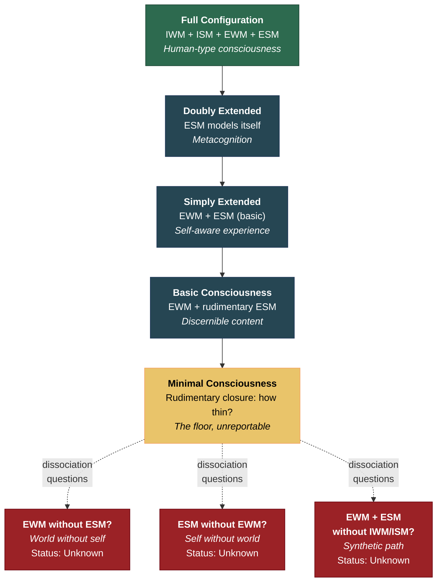

# Minimum Configuration for Consciousness

**Can the four model kinds partially dissociate? Is world-experience without self-experience possible? Self-experience without world-experience? The theory holds that all four model kinds are the minimum; how thin each can be, and how far they can dissociate while consciousness persists at each graduated level, remains an open empirical question.**

The [Four-Model Theory](../core-architecture/four-model-theory.md) names four model kinds as the minimum set the architecture forces for any consciousness (sufficiency needs the further conjunction of closure, free compute, embodiment and at least one pain-pleasure axis) — "four is the floor, not the ceiling": the [IWM](../core-architecture/implicit-world-model.md), [ISM](../core-architecture/implicit-self-model.md), [EWM](../core-architecture/explicit-world-model.md), and [ESM](../core-architecture/explicit-self-model.md). The derivation is architectural: each explicit model is generated from its implicit counterpart, and removing any one collapses the capacity for self-referential closure. The [graduated levels](../mechanisms/graduated-consciousness.md) framework adds that, above a single gate, consciousness comes in degrees — from [minimal consciousness](../mechanisms/minimal-consciousness.md) at the floor through metacognition to philosophical reflection. What remains open is how far the kinds can dissociate *within* that minimum, and how thin each can be while the architecture still closes.

## The Dissociation Questions

The four model kinds might partially dissociate, raising several specific questions:

**EWM without ESM: World-experience without self-experience.** Is it possible to have a conscious experience of a world without any sense of being a self experiencing it? This would be phenomenal experience without self-reference — a "view from nowhere" that is nevertheless a view. Certain reports from deep meditation and psychedelic states describe something like this: vivid perceptual experience with no sense of self. Whether these reports reflect genuine ESM absence (the model is not running) or merely ESM attenuation (the model is running at minimal intensity) is an open question.

**ESM without EWM: Self-experience without world-experience.** Is it possible to have a sense of self without any experience of an external world? Sensory deprivation and certain meditative states produce something like this — awareness of being aware, with minimal world-content. Deep NREM sleep does not qualify: on the theory it is probably unconsciousness, with brief cortical up-states that do not sustain the simulation (see [Sleep](../phenomena/sleep.md)).

**Rudimentary EWM + rudimentary ESM: Minimal consciousness.** The [graduated levels](../mechanisms/graduated-consciousness.md) framework places the floor at [minimal consciousness](../mechanisms/minimal-consciousness.md): "a rudimentary closure, consciousness at its minimum," in which the explicit world and self models close on each other around the present moment and a primordial pain or a nothingness. Basic consciousness is the next level up, at the same depth of recursion with discernible content. The open question is how thin the closing models can be: how little world content and how simple a self model still close, given that the self model must be "a model of the system itself, however simple," and that a position estimate updating a map does not qualify.

**EWM + ESM without ISM/IWM: Virtual models without substrate models.** This case is relevant to [artificial consciousness](../ai-consciousness/engineering-specification.md). The explicit models are generated from the implicit models in biological systems. Could a synthetic system run explicit models directly, without the implicit substrate models? The theory says no — the explicit models are generated *from* implicit models and require them as source material, and a system whose entire representational content is assigned at run time has no base layer to generate from. Learned weights are such a base layer; the claim can be probed in simulation.

## Implications for the Boundary Problem

The minimum configuration question is directly connected to the [boundary problem](../foundations/eight-requirements.md): where does consciousness begin? The [two thresholds](../physical-foundations/two-thresholds.md) (the Class 4 regime + architecture) provide a general answer, but the minimum configuration question asks for specificity: which architectural elements are essential at each level?

The theory's treatment of [animal consciousness](../phenomena/animal-consciousness.md) depends on this question. All four kinds are required, but the explicit ones can be rudimentary: minimal consciousness is a rudimentary closure of EWM and ESM. How rudimentary they can be decides how far the boundary extends. The theory's candidates for the floor are fish, amphibians and possibly insects; "an insect brain that sustains even a rudimentary closure has at least minimal consciousness."

## The Simulation Path

Resolving this question may require computational simulation rather than (or in addition to) empirical neuroscience. Building models with different configurations — EWM only, ESM only, both at varying intensities, with and without implicit models — and observing which configurations produce the behavioral signatures associated with consciousness could constrain the space of possible minimum configurations.

The [engineering specification](../ai-consciousness/engineering-specification.md) for artificial consciousness depends on this answer: building a conscious artifact requires knowing which components are essential and which are specific to biological implementation.

## Figure

## Key Takeaway

The four model kinds are the theory's minimum for any consciousness, but how thin each can be, and how far they can dissociate within that minimum, remains an open question. Its resolution would constrain the [boundary problem](../foundations/eight-requirements.md), the treatment of animal consciousness, and the engineering specification for artificial consciousness. This is one of the theory's most consequential open questions.

## See Also

- [The Four-Model Theory](../core-architecture/four-model-theory.md)
- [Graduated Levels of Consciousness](../mechanisms/graduated-consciousness.md)
- [Minimal Consciousness](../mechanisms/minimal-consciousness.md)
- [Two Thresholds for Consciousness](../physical-foundations/two-thresholds.md)
- [Engineering Specification for Artificial Consciousness](../ai-consciousness/engineering-specification.md)
- [Are the Implicit Models Also Virtual?](../open-questions/implicit-models-virtual.md)

---

Based on: Gruber, M. (2026). The Four-Model Theory of Consciousness. Zenodo. https://doi.org/10.5281/zenodo.18669891
