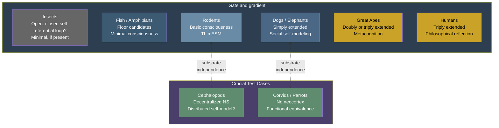

# Animal Consciousness

**An animal has phenomenology or it has none; above that gate, species are placed on a gradient by richness of content and depth of self-modeling, from minimal consciousness in fish, amphibians and possibly insects to extended consciousness in primates.**

The Four-Model Theory replaces "Is animal X conscious?" with two questions: does its nervous system close the explicit world and self models on each other, and if so, how rich and how deep is the self-modeling above that closure? The theory's commitments — [substrate independence](../philosophical/substrate-independence.md), the Class 4 computational regime (whose usual neural signature is near-[criticality](../physical-foundations/criticality.md)), and [graduated levels](../mechanisms/graduated-consciousness.md) above a single gate — predict a gradient determined "not by phylogenetic proximity to humans or behavioral sophistication but by whether the organism's neural architecture sustains self-referential simulation through free modeling."

## The Gate and the Gradient

Since phenomenality is closure, "a system has phenomenology or it has none, and without it no term of the consciousness family (consciousness, awareness, sentience, self-awareness) applies." Above the gate the theory distinguishes:

- **Minimal consciousness** (the floor): a rudimentary closure whose content is the present moment together with a primordial pain or a nothingness — no reflection, no modeled past or future, no discernible qualia, unreportable by definition. It is "the closest counterpart to what the animal-welfare literature calls sentience, the capacity for felt, valenced states." See [Minimal Consciousness](../mechanisms/minimal-consciousness.md).
- **Basic consciousness**: same depth of recursion, discernible content. An [EWM](../core-architecture/explicit-world-model.md) generates a world with discernible qualities; a rudimentary [ESM](../core-architecture/explicit-self-model.md) gives a thin sense of being its subject.
- **Simply extended**: first-order self-observation. The organism is aware that it experiences.
- **Doubly extended**: metacognition. The organism models itself modeling.
- **Triply extended**: philosophical self-reflection. Humans reach it; primates that show metacognition operate at doubly or triply extended levels.

Individual organisms move along both axes with arousal, attention and state. In the theory's vocabulary "self-model" means "a model of the organism itself, however simple, in proportion to what the organism has," not narrative autobiography.

## The Floor: Fish, Amphibians, Insects

"The theory's candidates for this level are fish, amphibians, and possibly insects." For insects the question is whether their neural circuits (mushroom body, central complex) "sustain a closed self-referential loop or constitute a sophisticated stimulus-response architecture without an inside perspective." Below closure there is no phenomenal experience regardless of behavioral sophistication; above it, "an insect brain that sustains even a rudimentary closure has at least minimal consciousness."

The floor cannot be reached by report. "Minimal consciousness is unreportable by definition, so in a species whose connectome and running activity cannot yet be inspected the evidence for it is behavioral analysis only; where they can be inspected, the [white-box trace](../predictions/white-box-trace.md) applies." The absence of sophisticated behavior does not show the absence of consciousness either: a system can be conscious while lacking the recursive depth that tool use or mirror recognition require.

## Mammals

Mammals implement the four-model architecture in graduated form. Even simple cortices (rodents) support basic consciousness: a rudimentary simulation sufficient for phenomenal experience but thin in self-awareness. Primates showing metacognition operate at doubly or triply extended levels; rodents likely possess basic or simply extended consciousness.

- **Pain and affect.** Mammals show behavioral, physiological and neural responses to noxious stimuli that parallel human pain experience. The [ISM](../core-architecture/implicit-self-model.md) processes interoceptive signals; the ESM generates the conscious experience of suffering.
- **REM sleep.** All mammals exhibit REM sleep, the state the theory identifies as degraded simulation mode. If REM involves virtual-model activity (dreaming), the four-model architecture is a conserved mammalian feature.
- **Theory of mind is not a rung.** The ladder counts self-recursion; modeling another agent is a world-model operation that reuses the self-model as a template. The species gradient records a correlation between the two, not a component.

## Crucial Test Cases

**Corvids and parrots** demonstrate tool manufacture, social deception, episodic-like memory and future planning, and mirror self-recognition has been reported in magpies, though replication attempts have failed. Yet they possess no neocortex: their pallium is organized in nuclear clusters (Güntürkün & Bugnyar, 2016). The theory predicts they *are* conscious, because its criterion is functional self-simulation through free modeling, not cortical layering.

**Cephalopods** extend the logic. Octopuses have largely decentralized nervous systems, with two-thirds of their neurons in the arms. The theory predicts that cephalopod consciousness, if present, would have unusual features: a self-model that may be distributed across a partially autonomous nervous system.

## The Boundary Problem

Where does consciousness begin? The [two thresholds](../physical-foundations/two-thresholds.md) give the necessary conditions: free compute (the Class 4 regime recruited for self-modeling) and the four-model architecture. Neither is sufficient; what is sufficient is the conjunction of the four models under closure, free compute, embodiment and at least one pain-pleasure axis. Animals are embodied and have pain-pleasure axes, so for an animal the deciding question is whether free modeling runs the four models under closure. Where it does, even rudimentarily, the animal is at least at the floor of minimal consciousness.

## Figure

*Animal consciousness above a single gate. Fish and amphibians are floor candidates, insects are minimal if their circuits close the loop, and mammals span basic to extended levels. Corvids and cephalopods test substrate independence: different neural organization, equivalent functional capacity.*

## Key Takeaway

Animal consciousness has one gate and a gradient above it. Closure decides whether an animal is conscious at all; richness of content and depth of self-modeling place it on the gradient, with fish, amphibians and possibly insects at the floor, the counterpart of sentience in the animal-welfare literature.

## See Also

- [Minimal Consciousness](../mechanisms/minimal-consciousness.md)
- [Graduated Levels of Consciousness](../mechanisms/graduated-consciousness.md)
- [Two Thresholds for Consciousness](../physical-foundations/two-thresholds.md)
- [Explicit Self Model (ESM)](../core-architecture/explicit-self-model.md)
- [Substrate Independence](../philosophical/substrate-independence.md)
- [Deciding Consciousness Without Report: The White-Box Trace](../predictions/white-box-trace.md)

---

Based on: Gruber, M. (2026). The Four-Model Theory of Consciousness. Zenodo. https://doi.org/10.5281/zenodo.18669891
