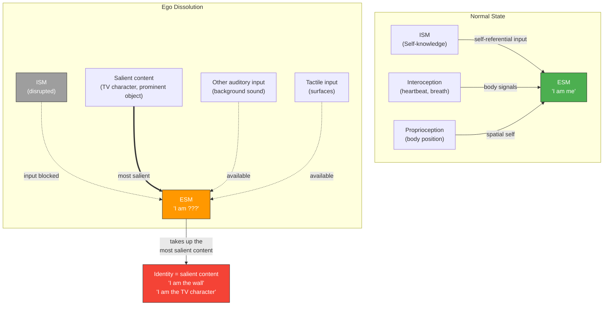

# Ego Dissolution

**During ego dissolution, the ESM is not abolished -- it is deprived of normal self-referential input and takes up the most salient content available, making identity content predictable and controllable.**

Ego dissolution -- the experience of losing one's sense of self, of boundaries dissolving between self and world -- is one of the most dramatic effects of high-dose psychedelics. Most accounts describe this as the self *disappearing*. The Four-Model Theory offers a more precise and more testable account: the **Explicit Self Model** (ESM) does not cease to operate. It continues running but loses its normal input, redirecting onto the most salient content available.

## The Redirectable ESM

The [ESM](../core-architecture/four-model-theory.md) is the brain's continuous generation of a unified self-narrative -- the sense of being a subject, having a perspective, occupying a body. Like any computational model, it requires input to operate on. Under normal conditions, the ESM receives a rich stream of self-referential signals: interoceptive data (heartbeat, breathing, gut feelings), proprioceptive feedback (body position, muscle tension), and the ongoing output of the [ISM](../core-architecture/four-model-theory.md) (accumulated self-knowledge, personality, autobiographical continuity).

High doses of some psychoactive drugs disrupt this self-referential input stream. The ESM does not shut down -- it has no off switch. Instead, it takes up the content most prominent in the explicit world-model at that moment: the figure a film is showing, a prominent object in the room. That content need have no relation to the subject's own heartbeat, breathing or movement.

## Salvia Divinorum: The Decisive Case

**Salvia divinorum** (salvinorin A, a κ-opioid agonist; [Roth et al., 2002](https://doi.org/10.1073/pnas.182234399)) provides the most dramatic illustration of this mechanism, drawn from a literature of user and case reports rather than controlled studies. Salvia users report experiences of *becoming* objects or entities in their immediate environment: becoming a piece of furniture, becoming a wall, becoming a character from a television show playing in the room, becoming a geometric pattern on the carpet. These reports are not metaphorical -- subjects describe literal identity replacement, experiencing themselves *as* the object.

The Four-Model Theory accounts for this. The ESM, deprived of normal self-input, takes up the most salient content in the scene -- a prominent object in the room, the character a television show is displaying. A television character carries no contingency with the viewer's body. On this account the identity experience should track salient content in an input-dependent and dose-dependent, and therefore *testable*, manner. The dose matters: at the highest doses salvinorin A gates external audiovisual input and abolishes body awareness ([Maqueda et al., 2015](https://doi.org/10.1093/ijnp/pyv065)), and identity can take up external content only while that content still reaches the subject. Whether classic serotonergic psychedelics produce the same migration onto external objects is open, since they intensify internally generated content, which competes with external input for salience.

## Figure

*In normal operation, the ESM receives self-referential input from the ISM and body signals. During ego dissolution, self-input is disrupted and the ESM redirects onto the most salient content, producing identity experiences that track the environment.*

## Controllability: The Prediction

This mechanism generates a testable prediction: **ego dissolution content is controllable** ([Prediction 2](../predictions/prediction-2-ego-dissolution.md)). If the ESM takes up the most salient content, then controlling what is salient during dissolution should control what the subject "becomes." IIT, GNW, HOT, and AST have no mechanism for specifying *what* a subject becomes during ego dissolution. Predictive processing has one: with the precision of self-priors relaxed ([Carhart-Harris & Friston, 2019](https://doi.org/10.1124/pr.118.017160)), belief about the self is set mainly by the most precise sensory channel. Input tracking as such is shared by the two accounts. They part where salience and bodily contingency come apart. Predictive accounts of bodily self-attribution weight signals synchronised with the subject's heartbeat ([Suzuki et al., 2013](https://doi.org/10.1016/j.neuropsychologia.2013.08.014); [Aspell et al., 2013](https://doi.org/10.1177/0956797613498395)) and predict identity following a faint synchronised stream. The Four-Model Theory predicts identity following the salient unsynchronised stream. A 2 × 2 design crossing salience with heartbeat synchrony, with a check that contingency-driven self-attribution is still intact under the drug, separates them.

## Cotard's Delusion: The Clinical Parallel

The redirectable ESM also explains **Cotard's delusion**, where patients believe they are dead or do not exist. The same mechanism operates through a different cause: neurological damage or psychiatric disorder severely distorts interoceptive input to the ESM. Deprived of normal embodied signals, the ESM constructs the best model it can from the distorted input -- and "I am dead" is the ESM's interpretation of the absence of normal body signals. Same mechanism as salvia's "I am a chair," different input disruption.

## Key Takeaway

Ego dissolution is not the disappearance of the self-model but its redirection. The ESM continues running and takes up the most salient content when self-referential signals are disrupted -- making the content of dissolution experiences predictable, controllable, and experimentally testable.

## See Also

- [Psychedelic Phenomenology](../phenomena/psychedelics.md)
- [Dissociative Identity Disorder](../phenomena/did.md)
- [The Four-Model Theory](../core-architecture/four-model-theory.md)
- [Self-Referential Closure](../core-architecture/self-referential-closure.md)
- [The Real/Virtual Split](../core-architecture/real-virtual-split.md)
