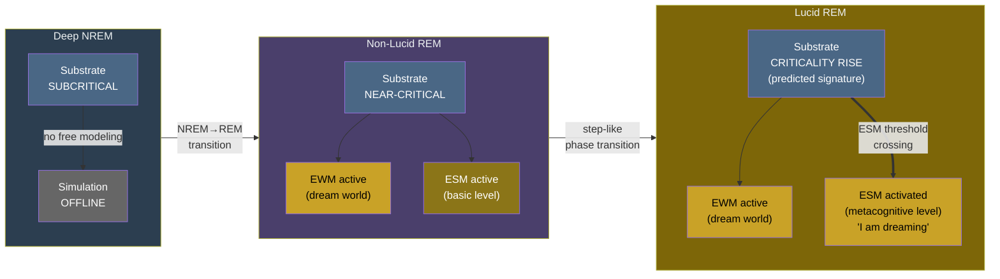

# Lucid Dreaming

**Lucid dreaming occurs when the ESM crosses from basic to extended consciousness during REM sleep, producing the self-aware experience of knowing one is dreaming; in cortex the theory expects the crossing to show as a step-like rise in criticality markers.**

In a lucid dream, the dreamer becomes aware *within* the dream that they are dreaming. This illustrates the [ESM](../core-architecture/explicit-self-model.md)'s software-like quality: the self-model "toggles on" more fully during an ongoing simulation, gaining metacognitive access without disrupting the dream world generated by the [EWM](../core-architecture/explicit-world-model.md). The Four-Model Theory accounts for lucid dreaming as a **threshold crossing** of the self-model -- a phase transition, not a gradual awakening -- and predicts a criticality threshold crossing as its signature in cortex.

## Dreams as Degraded Simulation

During ordinary (non-lucid) dreaming, the simulation runs in degraded mode. The substrate is near-[critical](../physical-foundations/criticality.md), with external sensory input substantially attenuated by thalamic gating.

The [EWM](../core-architecture/explicit-world-model.md) continues to generate a world, but without sensory constraint, it draws on the [IWM](../core-architecture/implicit-world-model.md)'s stored knowledge, producing dreams' characteristic features: familiar places, impossible physics, narrative incoherence. The [ESM](../core-architecture/explicit-self-model.md) continues to generate a self -- "you" experience dreams as happening to you -- but with reduced metacognitive depth. The dreaming self accepts impossible events without question because the ESM is operating at a lower [graduated level](../mechanisms/graduated-consciousness.md): basic consciousness without full self-reflective capacity.

## The Threshold Crossing

Lucid dream onset corresponds to the ESM activating at a higher graduated level. How deeply the ESM is active varies with how fully the substrate occupies the open-ended regime -- indexed, in neural tissue, by its position relative to the critical point -- so in cortex the activation should show as a criticality increase originating in self-model networks. The transition produces the characteristic "I am dreaming" insight -- a sudden metacognitive leap in which the self-model gains awareness of its own simulation status.

The theory predicts this transition shows the signature of a **phase transition** rather than a gradual ramp:

- **Critical slowing** in EEG complexity measures just before lucid onset, as the system approaches the threshold.
- **Abrupt jump** in criticality markers at the moment of lucid onset -- a step-like increase, not a gradual climb.
- **Spatial origination** in ESM-related cortical regions (medial prefrontal cortex, posterior cingulate cortex) before spreading to other areas.

This prediction is testable using the established lucid-dreamer eye-signaling paradigm (LaBerge, 1985) with concurrent high-density EEG, tracking criticality markers (branching ratio, DFA exponent, avalanche statistics) around the verified moment of lucid onset. Which markers can track the transition in real time is not yet settled, so the test depends on criticality measurement during sleep maturing. Elevated frontal gamma during lucid REM (Voss et al., 2009) rests on three lucid dreams and has been questioned as a possible ocular artifact; gamma power is in any case a spectral measure, not a criticality measure. The prediction concerns the signature, so its failure would not by itself disconfirm free modeling.

## The NREM/REM Cycle

Read through the [criticality](../physical-foundations/criticality.md) signature, the 90-minute ultradian cycle tracks the state of the explicit simulation:

- **Deep NREM**: The substrate is predominantly subcritical and the simulation is offline. The brief up-states of the slow oscillation are interrupted by down-states and do not sustain it; deep sleep is probably unconsciousness.
- **Light NREM**: The simulation runs intermittently and thin, producing short, thought-like mentation. NREM dreaming belongs here, in non-deep NREM, the reportable state closest to the floor of [minimal consciousness](../mechanisms/minimal-consciousness.md) ([Siclari et al., 2017](https://doi.org/10.1038/nn.4545)).
- **NREM-to-REM transition**: Free modeling resumes and the simulation restarts -- but on internal input rather than sensory input. In cortex this shows as a re-approach to criticality.
- **REM sleep**: The substrate operates near-critical, and dream consciousness runs. The EWM generates a world; the ESM generates a self. But the ESM operates at a lower graduated level than in waking.
- **Lucid dreaming**: The ESM reaches a higher graduated level -- simply extended or doubly extended consciousness within the dream -- with a step-like criticality rise as the predicted cortical signature.

Sleep onset itself is a bifurcation: not a gradual dimming of consciousness but a relatively abrupt collapse of the virtual simulation, with the substrate dropping below criticality. Pre-sleep imagery -- the hypnagogic progression from phosphenes through geometric patterns to complex scenes -- mirrors the psychedelic [permeability hierarchy](../mechanisms/variable-permeability.md), reflecting the gradual loosening of the [implicit-explicit boundary](../mechanisms/implicit-explicit-boundary.md) during the approach to sleep onset.

## Distinguishing Power

Other theories generate related but distinct predictions for lucid dreaming:

- **IIT** predicts increased Phi in the posterior hot zone -- a different spatial prediction from the ESM-network origination the Four-Model Theory predicts.
- **GNW** predicts prefrontal ignition, which overlaps with the medial prefrontal cortex prediction but without the criticality-threshold framing.
- **Predictive processing** predicts increased precision on self-model predictions -- compatible but does not predict a step-like criticality transition.

The combination of step-like transition *plus* ESM-network spatial origination *plus* criticality markers is distinctive to the Four-Model Theory.

## Figure

## Key Takeaway

Lucid dreaming is a threshold crossing of the self-model during REM sleep: the ESM activates at a higher graduated level, producing the metacognitive insight "I am dreaming." The theory predicts that in cortex this transition shows phase-transition dynamics in criticality markers (critical slowing, abrupt jump) originating in ESM-related cortical regions -- a testable prediction that distinguishes it from IIT, GNW, and predictive processing accounts.

## See Also

- [Criticality: Signature, Not Requirement](../physical-foundations/criticality.md)
- [Explicit Self Model (ESM)](../core-architecture/explicit-self-model.md)
- [Graduated Levels of Consciousness](../mechanisms/graduated-consciousness.md)
- [Variable Permeability](../mechanisms/variable-permeability.md)
- [Psychedelic Phenomenology](../phenomena/psychedelics.md)
- [Prediction 4: Lucid Dream Onset](../predictions/prediction-4-lucid-dreaming.md)

---

Based on: Gruber, M. (2026). The Four-Model Theory of Consciousness. Zenodo. https://doi.org/10.5281/zenodo.18669891
