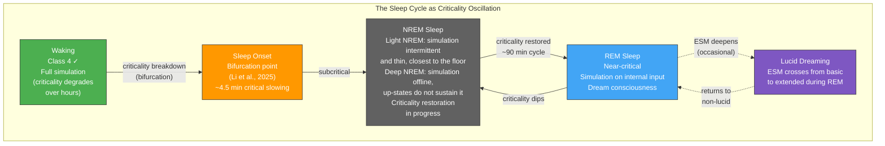

# Sleep, Dreams, and Criticality

**Sleep onset is a bifurcation -- a sharp breakdown, not gradual dimming. Deep NREM sleep is probably unconsciousness, light NREM is the reportable state closest to the floor of consciousness, and in REM free modeling resumes and the simulation runs on internal input.**

Sleep is not a passive shutdown of consciousness. The Four-Model Theory holds that "consciousness during sleep tracks the state of the explicit simulation, which can activate in REM and in non-deep NREM sleep when free modeling transiently resumes, showing in cortex as a transient approach to [criticality](../physical-foundations/criticality.md)." Falling asleep, dreaming, and waking up are transitions in whether the [virtual simulation](../core-architecture/four-model-theory.md) runs, and the substrate's distance from the critical point is the signature by which those transitions are read.

## Sleep Onset: Bifurcation, Not Fade

The theory predicts that sleep onset should be a **radical transition** -- a breakdown of [Class 4 dynamics](../physical-foundations/criticality.md) -- rather than a gradual dimming of consciousness: the simulation needs the Class 4 regime to run, and when the substrate leaves that regime the simulation collapses rather than thinning out.

This prediction is supported by [Li et al. (2025)](https://doi.org/10.1038/s41593-025-02091-1), who demonstrated in over 1,000 participants that falling asleep follows a **predictable bifurcation dynamic** -- a tipping point preceded by critical slowing (increased variance and autocorrelation in neural signals), with the transition detectable approximately 4.5 minutes before conventional sleep onset markers. The signature is characteristic of a dynamical system approaching a phase transition, not a gradual power-down.

## Pre-Sleep Imagery: The Permeability Hierarchy

The pre-sleep period offers a parallel to the [psychedelic permeability mechanism](../phenomena/psychedelics.md). As criticality begins to break down during the transition to sleep, the implicit-explicit boundary becomes increasingly permeable in the same hierarchical order observed under psychedelics:

1. **Phosphenes and visual snow** -- V1-level processing leaking through
2. **Geometric patterns** -- early visual tessellations and form constants (hypnagogic geometrics)
3. **Hypnagogic imagery** -- faces, scenes, fragmentary narratives from higher visual areas

This bottom-up progression parallels the psychedelic dose-response hierarchy, which the theory reads as the same permeability mechanism operating in both contexts. It remains a hypothesis: the cortical contribution to closed-eye phosphenes has not been cleanly separated from retinal sources. The cause is different (criticality degradation vs. pharmacological permeability increase), but the phenomenological sequence is the same because both expose the processing hierarchy in the same order.

## Figure

*The sleep cycle read through the criticality signature. Waking criticality degrades over hours, and sleep onset is a bifurcation. In deep NREM the simulation is offline while criticality is restored; light NREM sustains an intermittent, thin simulation. In REM free modeling resumes near the critical point, producing dream consciousness. Occasionally the ESM deepens during REM and the dream becomes lucid.*

## NREM: Criticality Restoration

The theory assigns NREM sleep a specific computational function: **restoring the criticality** that waking activity progressively degrades. An analog substrate (biological neurons) cannot sustain digital computation indefinitely without periodic recalibration. Waking experience drives the system progressively away from optimal criticality; NREM sleep restores it.

This prediction is supported by [Xu et al. (2024)](https://doi.org/10.1038/s41593-023-01536-9), who demonstrated in continuous 10-14 day recordings that normal waking experience progressively disrupts criticality, and that sleep restores the optimal computational regime. [Meisel et al. (2013)](https://doi.org/10.1523/JNEUROSCI.1516-13.2013) showed fading criticality signatures during sustained human wakefulness.

## REM: Periodic Re-Approach

During the 90-minute ultradian cycle, the substrate's criticality state oscillates. The theory separates two kinds of NREM sleep:

- **Deep NREM** is predominantly subcritical. The explicit models are offline, and consciousness is "probably absent (unconsciousness)." The up-states of the slow oscillation are brief and interrupted by down-states, and "on the theory they do not sustain the simulation."
- **Light NREM** is mostly subcritical with transient approaches to the critical point. The explicit models run "intermittent and thin," producing intermittent, thought-like mentation: "the reportable state closest to the floor" of [minimal consciousness](../mechanisms/minimal-consciousness.md). NREM dreaming belongs here. Reports of experience from NREM awakenings follow fewer and smaller slow waves ([Siclari et al., 2018](https://doi.org/10.1523/JNEUROSCI.0855-18.2018)) and a local reduction of low-frequency activity over posterior cortex ([Siclari et al., 2017](https://doi.org/10.1038/nn.4545)), which the theory reads as periods in which posterior cortex is locally out of deep sleep, whatever the stage score.

As restoration proceeds, the substrate periodically **re-approaches the critical point** -- the ultradian cycle "may reflect periodic re-approaches to the critical point during this restoration process" -- producing the transition to REM sleep. In REM the substrate approaches waking-level criticality and the simulation runs again, but with external sensory input substantially attenuated by thalamic gating. The [EWM](../core-architecture/four-model-theory.md) generates a world from stored knowledge (the IWM) rather than current sensation, producing the familiar dream phenomenology: familiar places, impossible physics, narrative incoherence, emotional intensity. The [ESM](../core-architecture/four-model-theory.md) generates a self -- dreams happen to "you" -- but with reduced metacognitive oversight.

**Lucid dreaming** occurs when the ESM crosses from basic consciousness (experiencing *as* an agent) to extended consciousness (experiencing *that* one is an agent experiencing) during REM: the "I am dreaming" realization. The theory's [Prediction 4](../predictions/prediction-4-lucid-dreaming.md) expects this onset to show as a **step-like criticality increase** -- a phase transition, not a gradual ramp -- originating in ESM-related cortical regions (medial prefrontal cortex, posterior cingulate cortex); the specific criticality signature at lucid onset remains an open empirical question.

## Key Takeaway

Sleep is read through the criticality signature: waking degrades criticality, sleep onset is a bifurcation (not gradual dimming), deep NREM is probably unconsciousness while criticality is restored, light NREM is the reportable state closest to the floor, and in REM free modeling resumes on internal input. Pre-sleep imagery follows the same hierarchical order as psychedelic imagery, which the theory attributes to a shared permeability mechanism.

## See Also

- [Criticality: Signature, Not Requirement](../physical-foundations/criticality.md)
- [Anesthesia and Loss of Consciousness](../phenomena/anesthesia.md)
- [Psychedelic Phenomenology](../phenomena/psychedelics.md)
- [Two Thresholds for Consciousness](../physical-foundations/two-thresholds.md)
- [Minimal Consciousness](../mechanisms/minimal-consciousness.md)
- [The Four-Model Theory](../core-architecture/four-model-theory.md)

---

Based on: Gruber, M. (2026). The Four-Model Theory of Consciousness. Zenodo. https://doi.org/10.5281/zenodo.18669891
