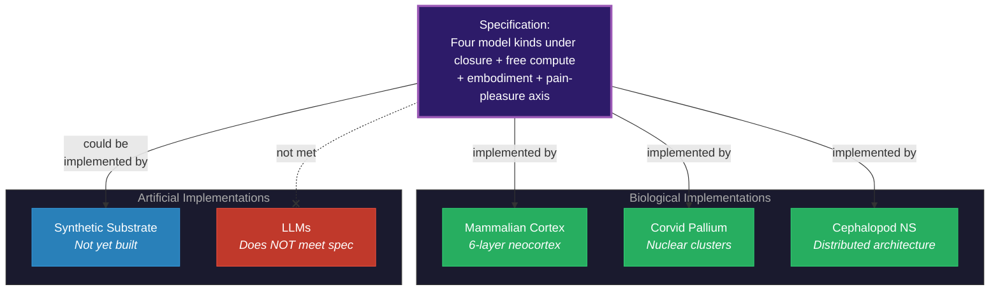

# Substrate Independence

**Consciousness depends on function, not on material: any physical system that meets the theory's sufficient conditions is conscious. The six-layer mammalian cortex is evolution's implementation, not a requirement.**

The Four-Model Theory is explicit: "any physical system that meets the sufficient conditions … — the four model kinds under closure, free compute in the Class 4 regime, embodiment, and at least one pain-pleasure axis — is conscious." The specific material -- biological neurons, silicon transistors, or something not yet invented -- is irrelevant. What matters is the computational architecture: four model kinds along [two axes](../core-architecture/two-axes.md) (mode, an orthogonal contrast; scope, a nesting), with self-referential closure, recruiting [free compute](../physical-foundations/criticality.md) for their own modeling, in a system with a body and a valence axis. The conditions are set out on [Two Thresholds for Consciousness](../physical-foundations/two-thresholds.md).

## Embodiment and Valence Without Biology

Two of the four conditions sound biological and are not.

**The pain-pleasure axis may be engineered.** "Presetting pain as aversive and pleasure as appetitive shortcuts what selection does by eliminating the creatures that get the sign wrong, so an engineered axis is compatible with substrate independence."

**Embodiment is a condition of natural emergence, not of existence.** "Embodiment is required for consciousness to emerge naturally, not for it to exist: the body is what gives the self model its content." The body need not be metabolic tissue: on the theory, a persistent artificial embodiment can supply the modeled "body" as well. A person locked in from birth, with little bodily content for the self model, would sit near the floor of [minimal consciousness](../mechanisms/minimal-consciousness.md).

## Why the Cortex Is Not the Point

The six-layer mammalian neocortex is an evolutionary implementation of the four-model architecture, not a requirement for it. The theory's requirements -- persistent models, dynamic simulation, self-referential closure, the Class 4 regime -- are functional specifications, not prescriptions of cortical anatomy. Laminar organization is one biological solution to them; the non-neocortical evidence below shows that others exist.

## Biological Evidence

Biological diversity already demonstrates substrate independence in practice.

**Corvids** (crows, ravens) and **parrots** demonstrate tool use, planning, mirror self-recognition, and social cognition -- cognitive abilities that strongly suggest consciousness. Yet their brains have no neocortex. Their pallium is organized in nuclear clusters rather than layers.

**Cephalopods** (octopuses) demonstrate problem-solving and behavioral flexibility with an even more radically different brain architecture -- a distributed nervous system with significant autonomy in the arms.

If the Four-Model Theory is correct, these animals are conscious not because they share mammalian neural architecture but because they have evolved functionally equivalent self-simulation architectures on different substrates -- exactly what substrate independence predicts.

## The Deeper Grounding

Substrate independence has a grounding beyond biological diversity. The universe is demonstrably capable of Class 4 dynamics: self-organized criticality, fractal structure, and edge-of-chaos phenomena are ubiquitous in natural systems. A universe capable of Class 4 dynamics is, by Wolfram's equivalence principle, capable of universal computation. One might conjecture that a Class 4-capable universe of sufficient scale makes self-simulating architectures statistically likely rather than merely possible. This is speculation, not a supporting part of the theory, and in any case consciousness would arise only in the subset of architectures that autonomously deploy that capacity for self-modeling -- capability alone, as in any heteronomous universal system such as a laptop, does not suffice.

## Implications for Artificial Consciousness

The implication is direct: a synthetic system that implements the four model kinds under closure, with free compute, an embodiment and at least one pain-pleasure axis, would be conscious. Current AI systems do not meet this specification. A base LLM lacks persistent implicit models, lacks an ongoing self-simulation (its autoregressive loop closes over the emitted text, not over a self-model), and lacks the [real/virtual split](../core-architecture/real-virtual-split.md) that grounds phenomenality. Post-trained models do carry a reportable representation of their own point of view inside a globally available workspace ([Gurnee et al., 2026](https://arxiv.org/abs/2607.15495)); what they lack is closure over it, persistence, and the Class 4 regime. Scaffolding -- agent loops, persistent memory, self-monitoring -- is architectural mimicry, not self-referential closure. The difference the theory asserts is architectural rather than impressionistic: closure, persistence, and computational regime are properties measurable on the system itself — closure by the [white-box trace](../predictions/white-box-trace.md), since an artificial system's weights and running dynamics are open to inspection.

## Figure

*Substrate independence means the specification (the four model kinds under closure, free compute, embodiment and a pain-pleasure axis) can be met by multiple physical substrates. On the theory, three biological implementations already exist. A synthetic implementation has not yet been built. Current LLMs do not meet the specification.*

## Key Takeaway

Consciousness is substrate-independent because it is defined by computational architecture, not by material composition. The six-layer cortex is one of evolution's implementations -- corvids and cephalopods strongly suggest it is not the only one -- and a correctly engineered artificial system should be another.

## See Also

- [The Four-Model Theory](../core-architecture/four-model-theory.md)
- [Process Physicalism](process-physicalism.md)
- [Two Thresholds for Consciousness](../physical-foundations/two-thresholds.md)
- [Criticality: Signature, Not Requirement](../physical-foundations/criticality.md)
- [The AI Diagnostic](../ai-consciousness/ai-diagnostic.md)

---

Based on: Gruber, M. (2026). The Four-Model Theory of Consciousness. Zenodo. https://doi.org/10.5281/zenodo.18669891
