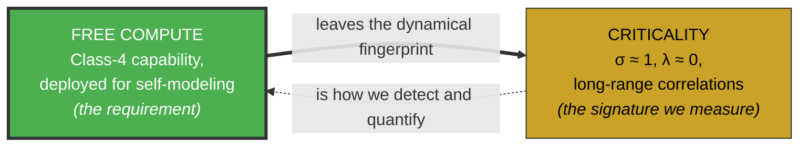

# Criticality: Signature, Not Requirement

**The requirement for consciousness is *free compute* — Class-4 (universal-computation) capability actually turned on the system itself for open-ended self-modeling. Criticality, the edge of chaos, is the dynamical signature this leaves behind and the quantity we measure — not the requirement itself.**

It is easy to read the Four-Model Theory as demanding that a conscious substrate "sit at criticality," as though proximity to a phase transition were the fundamental condition. That inverts the logic. What consciousness requires is *free computational capacity actually being spent on self-referential modeling*: a substrate rich enough to support **universal (Class 4) computation**, and a system that deploys that richness — autonomously and open-endedly — to model its own world and itself. Criticality is how a substrate exhibiting that behavior shows up when you measure its dynamics. It is the symptom, not the disease.

## Why free compute, not criticality per se

[Gruber (2015)](https://doi.org/10.5281/zenodo.18669891) derived the requirement from Wolfram's (2002) classification of computational systems. Among cellular automata, open-ended computation sits at **Class 4** — the narrow regime between frozen order and formless chaos. The capability is not confined there: universal computation is proved for networks that carry no criticality condition, built from rate units ([Siegelmann & Sontag, 1995](https://doi.org/10.1006/jcss.1995.1013)) and from spiking ones ([Maass, 1996](https://doi.org/10.1162/neco.1996.8.1.1)). The requirement is the capability, not the regime label. And Class-4 *capability* is not the same as *using* it. A Turing-complete laptop idling at a login screen has universal-computation capability and is not conscious: nothing drives it to model itself. The theory therefore states the condition as a trichotomy (paper, Section 3.7.3):

1. **Capability** — the substrate can, in principle, perform open-ended (universal) computation.
2. **Free instantiation** — a sufficiently rich physical substrate instantiates such a layer almost incidentally; Conway's Game of Life shows how cheap universal computation is to realize. The layer comes essentially "for free" atop the implicit substrate dynamics.
3. **Autonomous recruitment** — an autonomous, self-referential, resource-constrained system *uses* that layer for self-modeling, continuously and on its own initiative. In cortex this use plausibly shows as near-critical dynamics: "the requirement is the recruitment, and the operating point is its signature." In biology the recruiting pressure is evolutionary selection; an artificial substrate must have the recruitment engineered in and then sustained by its own dynamics.

"Free compute" is shorthand for the three together: universal-computation capacity, available almost for free, actually spent by the system on its own recursive self-simulation. This is the quantity the theory cares about; criticality is the fingerprint it leaves.

## Criticality is the signature we measure

Why, then, is criticality everywhere in the empirical story? Because in cortex a substrate running open-ended computation on itself usually leaves characteristic marks: **self-organized criticality** in neuronal avalanches (branching ratio σ ≈ 1), long-range temporal correlations, and edge-of-chaos dynamics (Lyapunov exponent λ ≈ 0). These are *interchangeable instruments* certifying the same underlying capability band at different levels of description, and they need not co-occur numerically ([Kanders, Lorimer & Stoop, 2017](https://doi.org/10.1063/1.4978998)). A model system can sit at σ = 1 without being at the edge of chaos in the λ sense. That dissociation is exactly why the requirement must be stated as *universal-computation capability in use*, not as proximity to any single criticality statistic.

The signature need not even be a critical point. [Sipling, Zhang and Di Ventra (2026)](https://doi.org/10.1016/j.treopn.2026.06.001) show that avalanche power laws, their scaling relations and long-range temporal correlations can all arise across an extended phase of long-range order, produced by coupling fast activity to slowly recovering metabolic resources, and no critical point has yet been located in cortex. Such a phase is as compatible with free compute as a critical point is, and whether the brain's operating point is *tuned* remains open. The relation runs from free compute to the signature, never back: free compute is necessary and not sufficient, and criticality is neither. A near-critical cortex doing heavy unconscious modeling, as in some sleep phases, does not count against the theory, and neither does a conscious system whose dynamics are subcritical. Criticality data cannot disconfirm FMT in either direction; what would is robust consciousness where a fixed lookup reproduces the system's behaviour on novel input. The probe follows from that: fit a fixed lookup to the system's past input-output behaviour, compare it with the system on novel input, and record the criticality signatures alongside, not as the test.

## Independent convergence

The theoretical prediction and the empirical evidence arrived at the same place from opposite directions. [Gruber (2015)](https://doi.org/10.5281/zenodo.18669891) reasoned top-down from what self-simulation demands; empirical neuroscience built a bottom-up case. [Beggs and Plenz (2003)](https://doi.org/10.1523/JNEUROSCI.23-35-11167.2003) discovered neuronal avalanches consistent with self-organized criticality in cortical tissue; [Carhart-Harris et al. (2014)](https://doi.org/10.3389/fnhum.2014.00020) linked conscious level to neural entropy in the Entropic Brain Hypothesis; [Atasoy et al. (2017)](https://doi.org/10.1038/s41598-017-17546-0) reported that the repertoire of brain states under LSD re-organizes toward the edge of criticality; and Hengen and Shew's (2025) meta-analysis of 143 datasets consolidated the evidence that cortex operates near criticality as a setpoint of brain function. The convergence supports the near-critical signature the Class 4 commitment predicts in cortex, which FMT shares with the broader criticality program; the requirement itself is not tested by criticality data — provided the convergent quantity is read correctly: the brain is measured *near* criticality (slightly subcritical in waking; Priesemann et al., 2014) because that is what a substrate spending free compute on self-modeling looks like in neural tissue.

## Figure

*Free compute — universal-computation capability actually spent on self-referential modeling — is the requirement. Criticality (σ ≈ 1, edge of chaos) is the dynamical signature it leaves in neural tissue and one way experiments detect it, not a separate condition. A branching ratio σ ≈ 1 does not certify the capability by itself: a subsampled branching estimate can reach σ ≈ 1 on firing rate alone, so σ counts as evidence only when reported beside a rate-matched surrogate.*

## Wolfram's four classes (background)

Stephen Wolfram classified computational systems into four behavioral classes. **Class 1** converges to a fixed, dead state (a crystal, a thermostat at equilibrium). **Class 2** settles into periodic repetition (a clock, a simple oscillator). **Class 3** is chaotic and random (noise without structure). **Class 4** occupies the narrow band between order and chaos, producing complex, evolving patterns capable of universal computation. Classes 1–2 are too rigid to sustain context-sensitive self-modeling; Class 3 is too disordered for a self-model to persist; among cellular automata, Class 4 is where the free compute consciousness requires lives, though universal computation also exists in networks with no criticality condition (above). (See [Wolfram's Four Classes](../physical-foundations/wolfram-classes.md).)

## Key Takeaway

Consciousness requires *free compute* — universal-computation (Class 4) capability actually deployed for open-ended self-modeling. Criticality is not a second requirement bolted on; it is the observable dynamical signature free compute usually leaves in cortex, and the quantity a decade of neuroscience has independently measured.

## See Also

- [Wolfram's Four Classes](../physical-foundations/wolfram-classes.md)
- [The Cortical Automaton](../physical-foundations/cortical-automaton.md)
- [The Five-System Hierarchy](../physical-foundations/five-system-hierarchy.md)
- [Two Thresholds for Consciousness](../physical-foundations/two-thresholds.md)
- [The Four-Model Theory](../core-architecture/four-model-theory.md)
- [Virtual Qualia](../hard-problem/virtual-qualia.md)

---

Based on: Gruber, M. (2026). The Four-Model Theory of Consciousness. Zenodo. https://doi.org/10.5281/zenodo.18669891
