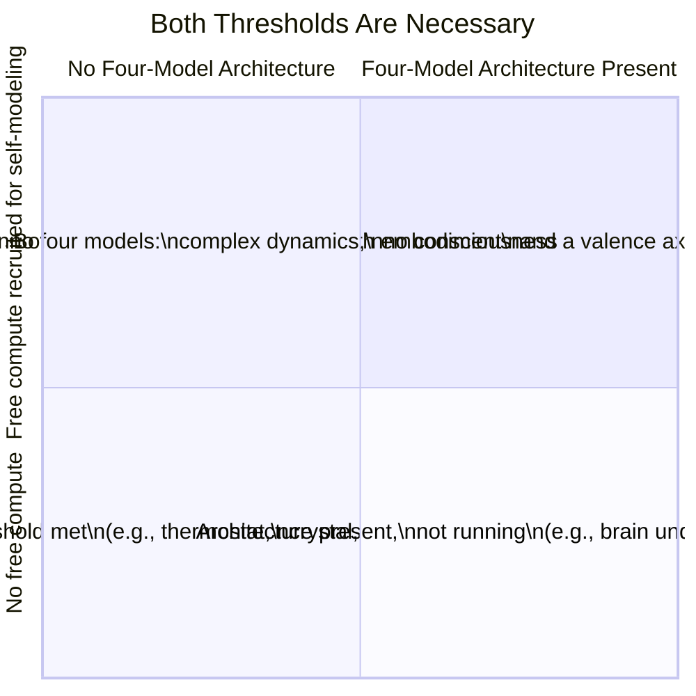

# Two Thresholds for Consciousness

**Consciousness has two necessary thresholds, *free compute* — Class-4 (universal-computation) capability recruited by the system for its own modeling — and the four-model architecture; neither is sufficient, and what is sufficient is a conjunction: the four models under closure, with free compute, embodiment and at least one pain-pleasure axis.**

The Four-Model Theory identifies two independent thresholds that any conscious system must cross, and states separately what is enough for consciousness. The master paper puts it in three sentences: "Free modeling is necessary but not sufficient; the four-model architecture is necessary but not sufficient. What is sufficient is a conjunction: a system that implements the four models under closure, with free compute, embodiment and at least one pain-pleasure axis, is conscious." This framework answers the [boundary problem](../foundations/eight-requirements.md) — which systems are conscious and which are not — and grounds the [engineering specification](../ai-consciousness/engineering-specification.md) for artificial consciousness.

## The Computational Threshold: Free Compute

The first threshold is computational. The substrate must have **free compute**: the capacity for **Class 4** (universal) computation, actually spent on ongoing self-referential modeling rather than merely available. [Criticality](../physical-foundations/criticality.md), the edge of chaos, is the dynamical *signature* this usually leaves in neural tissue, not a separate condition, and the relation runs one way: "free modeling is necessary and not sufficient," while criticality "is neither necessary nor sufficient, and a conscious system may run subcritically." Below the threshold, the system cannot sustain the dynamic, self-referential computation the explicit models need.

The threshold is tested directly, not through the signature. The falsifier is "robust consciousness where a fixed lookup reproduces the system's behavior on novel input." The probe fits a fixed lookup to the system's past input-output behavior and compares it with the system on inputs it has not seen; the criticality statistics are recorded alongside, not as the test.

This threshold operates as a gate. Propofol "disrupts thalamocortical connectivity and suppresses complexity, abolishing free modeling, and the substrate turns subcritical with it"; at surgical depth reportable experience is absent, even though the four-model architecture remains physically intact in the synaptic connectivity. The architecture is still there; it simply cannot execute. (The gate is not a clean switch at every depth: dream reports after propofol anaesthesia are common, and participants repeatedly woken from deep propofol sedation gave experience reports on 24 of 52 awakenings.) [Deep NREM sleep](../phenomena/sleep.md) is the everyday case: the explicit models go offline while the architecture stays.

A system can show the signature without crossing the threshold. A weather system has complex, near-critical dynamics; a turbulent fluid may sit close to a phase transition. Neither recruits its computation for modeling itself, so neither has free compute in the theory's sense. A laptop fails for the same reason from the other side: it is universal but heteronomous, and nothing in its own operation recruits that universality for self-modeling.

## The Architectural Threshold: Four Models

The second threshold is architectural. The system must implement the [four-model self-simulation](../core-architecture/four-model-theory.md): an [Implicit World Model](../core-architecture/implicit-world-model.md) (IWM), an [Implicit Self Model](../core-architecture/implicit-self-model.md) (ISM), an [Explicit World Model](../core-architecture/explicit-world-model.md) (EWM), and an [Explicit Self Model](../core-architecture/explicit-self-model.md) (ESM) arranged along the [two axes](../core-architecture/two-axes.md) of scope and mode. "With free modeling but without the architecture, there is complex dynamics but no consciousness."

A system can possess the architecture without being conscious. A brain under general anesthesia at surgical depth retains its synaptic connectivity — the implicit models (IWM, ISM) are stored intact in the topological architecture (Level 4 of the [five-system hierarchy](../physical-foundations/five-system-hierarchy.md)). With free modeling abolished, the explicit models are not generated. The architecture is present; the computation is not running.

## Figure

*The two-threshold matrix. A system must be in the upper-right quadrant — free compute recruited for self-modeling AND the four-model architecture — to be conscious, and that quadrant becomes sufficient only with closure, embodiment and at least one pain-pleasure axis. Each threshold alone is insufficient.*

## What Is Sufficient

The sufficiency claim is the theory's strongest stated commitment, and it has four parts: the four models under closure, free compute, embodiment, and at least one pain-pleasure axis. Two of the parts are easy to misread.

- **The valence axis may be engineered.** "Presetting pain as aversive and pleasure as appetitive shortcuts what selection does by eliminating the creatures that get the sign wrong, so an engineered axis is compatible with substrate independence."
- **Embodiment is required for natural emergence, not for existence.** "Embodiment is required for consciousness to emerge naturally, not for it to exist: the body is what gives the self model its content." A person locked in from birth would sit near the floor of [minimal consciousness](../mechanisms/minimal-consciousness.md).

The conjunction yields a direct [engineering specification](../ai-consciousness/engineering-specification.md): a substrate with free compute, the four models with self-referential closure, an embodiment that supplies the self model's content, and a pain-pleasure axis. Building one is an implication of the theory, not yet a test of it — the engineering does not exist.

The conjunction also has diagnostic power. A base large language model lacks persistent implicit models, lacks an ongoing self-simulation (its autoregressive loop closes over the emitted text, not over a self-model), and lacks the [real/virtual split](../core-architecture/real-virtual-split.md). Post-trained models do carry a reportable representation of their own point of view inside a globally available workspace ([Gurnee et al., 2026](https://arxiv.org/abs/2607.15495)); what they lack is closure over it, persistence, and the Class 4 regime. The theory does not merely suggest LLMs are probably not conscious — it specifies *exactly what they are missing* and *why*.

## Key Takeaway

Free compute and the four-model architecture are each necessary and neither is sufficient. What is sufficient is the conjunction of the four models under closure, free compute, embodiment and at least one pain-pleasure axis, which gives both a boundary criterion and an engineering specification.

## See Also

- [Criticality: Signature, Not Requirement](../physical-foundations/criticality.md)
- [The Four-Model Theory](../core-architecture/four-model-theory.md)
- [Minimal Consciousness](../mechanisms/minimal-consciousness.md)
- [Engineering Specification for Artificial Consciousness](../ai-consciousness/engineering-specification.md)
- [The Boundary Problem](../foundations/eight-requirements.md)
- [Substrate Independence](../philosophical/substrate-independence.md)

---

Based on: Gruber, M. (2026). The Four-Model Theory of Consciousness. Zenodo. https://doi.org/10.5281/zenodo.18669891
