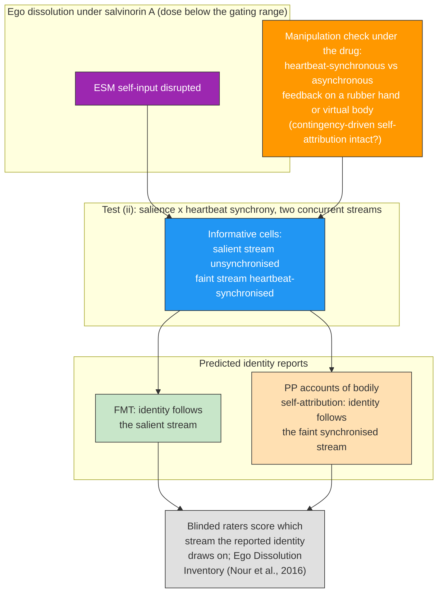

# Prediction 2: Ego Dissolution Content Is Controllable

**During ego dissolution under salvinorin A, identity content tracks the most salient content in the sensory environment, even when that content has no relation to the subject's own body -- control what is salient, control what the subject "becomes."**

Several theories can explain *that* ego dissolution occurs (self-model weakening, prior relaxation). The Four-Model Theory predicts *what content* replaces the dissolved self: the figure a film is showing at that moment, or a prominent object in the room. Predictive processing also predicts that identity content follows input. The two accounts part where salience and bodily contingency come apart, and the prediction includes a test for that case.

## The Mechanism: Input-Dependent Identity

The [ESM](../core-architecture/four-model-theory.md) is the brain's continuous generation of a unified self-narrative. Like any computational model, it requires input. Under normal conditions, the ESM receives self-referential signals: interoceptive data (heartbeat, breathing), proprioceptive feedback (body position), and ongoing output from the [ISM](../core-architecture/four-model-theory.md) (accumulated self-knowledge, personality, autobiographical continuity).

During [ego dissolution](../phenomena/ego-dissolution.md), this self-referential input stream is disrupted. The ESM does not shut down -- it has no off switch. It continues running and takes up the content most prominent in the explicit world-model at that moment. This is the [redirectable ESM](../mechanisms/redirectable-esm.md) mechanism: the self-model is not destroyed but redirected.

The prediction follows: if identity content during dissolution tracks the most salient content, then varying what is salient should vary the identity content in a predictable way.

## Existing Reports: Salvia Divinorum

Salvinorin A, the κ-opioid agonist in *Salvia divinorum* ([Roth et al., 2002](https://doi.org/10.1073/pnas.182234399)), is the drug the prediction is stated for. Salvia users report *becoming* objects in their immediate environment: furniture, walls, the characters of a television show playing in the room. These are user and case reports, not controlled studies. They fix which reading the theory asserts. They do not test it.

A television character is salient and carries no contingency with the viewer's heartbeat, breathing or movement. On the Four-Model Theory, the ESM, deprived of normal self-input, takes up that salient content. The controlled version has not been done: manipulating salience and measuring the correspondence.

Salvinorin A also suits the test. Inhaled, its subjective effects peak within minutes and are gone after about twenty, and in a controlled study it did not significantly raise heart rate or blood pressure ([Johnson et al., 2011](https://doi.org/10.1016/j.drugalcdep.2010.11.005)). Its effects set a dose window. External audiovisual input is gated in a dose-dependent way, and body awareness rises at lower doses and is lost at the highest ([Maqueda et al., 2015](https://doi.org/10.1093/ijnp/pyv065)). Identity can take up external content only while that content still reaches the subject, so the tests run at doses below the gating range. Whether classic serotonergic psychedelics such as psilocybin produce the same migration onto external objects is open: they intensify internally generated content, which on this account competes with external input for salience.

## Figure

*The discriminating design: two concurrent stimulus streams, one made salient and one pulsed in synchrony with the subject's heartbeat. The two accounts disagree only in the cells where salience and synchrony fall on different streams.*

## Proposed Test Protocol

Two tests follow, both run during ego dissolution under salvinorin A at a dose inside the window described above, confirmed by the Ego Dissolution Inventory ([Nour et al., 2016](https://doi.org/10.3389/fnhum.2016.00269)).

1. **Test (i): salience and identity.** Vary which content is salient, and in which modality (visual, auditory, tactile). Blinded raters score the correspondence between the controlled input and the reported identity content.
2. **Test (ii): salience against bodily contingency.** A 2 × 2 within-subject design presents two concurrent stimulus streams. One factor sets which stream is salient, the other which stream is pulsed in synchrony with the subject's heartbeat, with asynchronous pulsing as the control ([Suzuki et al., 2013](https://doi.org/10.1016/j.neuropsychologia.2013.08.014)). Salience is fixed in advance from a waking session (salience ratings and gaze dwell), not inferred from the outcome. The informative cells pair a salient unsynchronised stream with a faint synchronised one. Blinded raters score which stream the reported identity draws on.
3. **Manipulation check.** The same session includes heartbeat-synchronous against asynchronous visual feedback on a rubber hand or virtual body ([Suzuki et al., 2013](https://doi.org/10.1016/j.neuropsychologia.2013.08.014); [Aspell et al., 2013](https://doi.org/10.1177/0956797613498395)), to confirm that contingency still drives self-attribution under the drug.

## Falsification Conditions

If identity content during ego dissolution shows no systematic relationship to the sensory environment, the redirectable-ESM mechanism is wrong. If, with the manipulation check showing contingency-driven self-attribution intact, identity content follows the faint synchronised stream over the salient unsynchronised one, the salience claim is wrong: the redirected ESM then follows bodily contingency.

## Distinguishing Power

IIT, GNW, HOT, and AST have no mechanism for specifying *what* a subject will become during ego dissolution. Predictive processing has one. Under REBUS ([Carhart-Harris & Friston, 2019](https://doi.org/10.1124/pr.118.017160)), psychedelics relax the precision of high-level priors, including priors about the self. When sensory channels carry different precisions, belief about the self is then set mainly by the most precise channel, and identity content tracks it. The precision-weighted account of self-recognition ([Apps & Tsakiris, 2014](https://doi.org/10.1016/j.neubiorev.2013.01.029)) produces the same pattern in waking, where seen touch captures felt ownership ([Botvinick & Cohen, 1998](https://doi.org/10.1038/35784)). Input tracking as such is therefore shared with predictive processing, and test (i) does not separate the two accounts. It tests their shared claim against theories with no mechanism for it.

Test (ii) separates them. Predictive accounts of bodily self-attribution weight contingency between a signal and the subject's own body: heartbeat-synchronised feedback increases ownership of a rubber hand and shifts self-identification toward a virtual body ([Suzuki et al., 2013](https://doi.org/10.1016/j.neuropsychologia.2013.08.014); [Aspell et al., 2013](https://doi.org/10.1177/0956797613498395)). They predict that identity follows the synchronised stream even when it is faint. The [redirectable ESM](../mechanisms/redirectable-esm.md) predicts that identity follows the salient stream regardless of synchrony. A predictive model in which the drug also abolishes contingency inference, leaving attention alone to set precision, predicts the Four-Model Theory's result. The manipulation check excludes that model in sessions where it passes, and sessions where it fails do not discriminate.

## Key Takeaway

Ego dissolution content is not random. The ESM takes up the most salient content when self-referential signals are disrupted, which makes dissolution content predictable and controllable. Input tracking is shared with predictive processing. The Four-Model Theory's own content is that identity follows salience where salience and bodily contingency come apart, and a 2 × 2 design with an under-drug contingency check tests it.

## See Also

- [Ego Dissolution](../phenomena/ego-dissolution.md)
- [The Redirectable ESM](../mechanisms/redirectable-esm.md)
- [Psychedelic Phenomenology](../phenomena/psychedelics.md)
- [The Explicit Self Model](../core-architecture/four-model-theory.md)
- [Prediction 1: Psychedelics Alleviate Anosognosia](prediction-1-anosognosia.md)
- [Prediction 3: DID Alter Switches Show Self-Referential Network Specificity](prediction-3-did.md)
