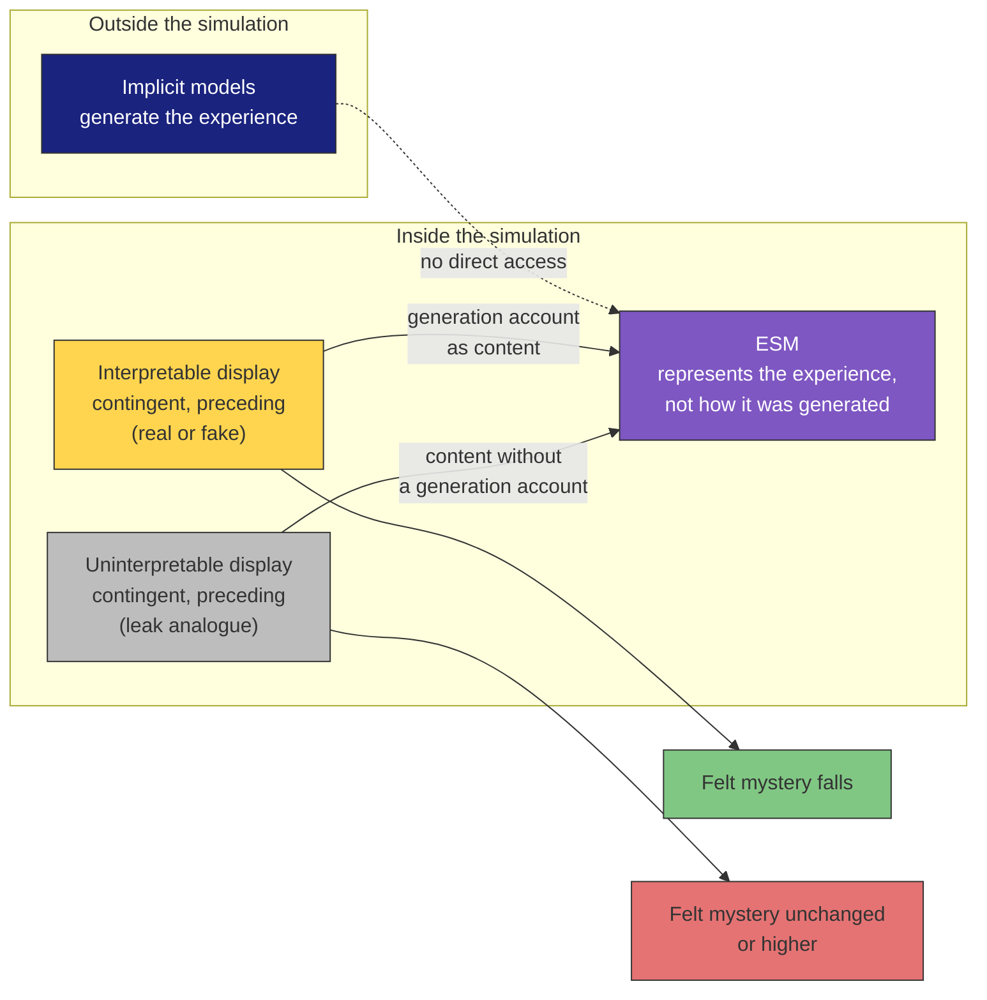

# Prediction 6: A Simulated Generation Account Reduces Felt Mystery

**A display of a plausible build-up of "your own processing", contingent on a percept or decision and shown before it, should lower the participant's reported mystery about how that experience came about, whether or not the display is veridical.**

## The Prediction

A participant watches a display that appears to show their own processing building up toward a percept or a decision. The display is contingent on what they then perceive or choose, and it comes first. Their reported mystery about how that experience came about should fall, and whether the display is veridical should make no difference.

A display that is equally contingent and equally timed but cannot be interpreted should leave the mystery unchanged or raise it.

## Derivation

The prediction comes from the third principle by way of the theory's account of the [meta-problem](../hard-problem/meta-problem.md). The **Explicit Self Model** ([ESM](../core-architecture/explicit-self-model.md)) can represent that it is having an experience. It cannot represent the mechanism that generates the experience, because that mechanism runs in the implicit models, outside the simulation. The ESM's observational horizon is bounded by the [Explicit World Model](../core-architecture/explicit-world-model.md), so information about the substrate can reach it only as content inside the simulation.

On this account the sense of mystery is the self-model's representation of an experience that has no generation account. Any input that places a generation account inside the simulation removes that absence, whatever its source. A fake display and a real one reach the self-model by the same route, which is why the theory predicts no advantage for the veridical one. An uninterpreted leak from the substrate, of the kind [variable permeability](../mechanisms/variable-permeability.md) allows, carries no generation account and should not lower the mystery.

## Figure

*The self-model has no route to the mechanism that generates its experience. A display reaches it only as content inside the simulation. An interpretable display supplies a generation account by that route, whether it is real or fake; an uninterpretable display with the same timing supplies none.*

## Proposed Test

A within-subject design with four arms:

1. A contingent display that precedes the experience.
2. The same display, mistimed or uncorrelated with the experience.
3. No display.
4. A contingent, preceding display that cannot be interpreted.

Percept trials use images that go from degraded to clear. Decision trials use cued free choices or primed outcomes (Wegner & Wheatley, 1999). A veridical sub-arm drives the display from a real-time readiness-potential interface (Schultze-Kraft et al., 2016). Fake precursor feedback is already known to shift self-attribution (Valins, 1966; Banks & Isham, 2009; Aarts et al., 2005).

No validated instrument for felt mystery about one's own experience exists. Per-trial ratings built on hard-problem intuition items (Díaz, 2021; Gottlieb & Lombrozo, 2018) have to be validated as part of the work. Arm 2 controls for belief and content. Arm 4 controls for timing and predicts the opposite direction, which demand characteristics would not produce.

## Falsification Conditions

The theory's account of the meta-problem is wrong if any of the following holds:

- The preceding contingent display does not lower mystery relative to the mistimed one, at matched belief in the display.
- The veridical display lowers mystery more than the fake one.
- The uninterpretable display lowers mystery as much as the interpretable one.

Such a failure leaves [self-referential closure](../core-architecture/self-referential-closure.md) untouched.

## Distinguishing Power

- **Accounts on which the mystery tracks a real explanatory gap** predict no effect of a fake display.
- **Attention Schema Theory** (Graziano & Webb, 2015) shares the explanation, a self-model that omits mechanism, and places it in an automatic attention schema that an external display does not alter. On FMT's reading AST therefore predicts a weaker effect or none, and illusionism reads the same way. Neither has published such a prediction.

The prediction is shared in part with these accounts.

## Key Takeaway

If felt mystery is the self-model's representation of an experience without a generation account, then giving the self-model a generation account should reduce it, even when the account is fake. An uninterpretable display with the same timing should not.

## See Also

- [The Meta-Problem: FMT's Account](../hard-problem/meta-problem.md)
- [The Explicit Self Model](../core-architecture/explicit-self-model.md)
- [Variable Permeability](../mechanisms/variable-permeability.md)
- [The Explanatory Gap](../hard-problem/explanatory-gap.md)
- [Prediction 7: Shortening the Echo Window Makes Experience Frame-Like](prediction-7-echo-window.md)
- [The FMT Prediction Map](prediction-map.md)

## References

- Aarts, H., Custers, R., & Wegner, D.M. (2005). On the inference of personal authorship: Enhancing experienced agency by priming effect information. *Consciousness and Cognition*, 14(3), 439–458. https://doi.org/10.1016/j.concog.2004.11.001
- Banks, W.P., & Isham, E.A. (2009). We infer rather than perceive the moment we decided to act. *Psychological Science*, 20(1), 17–21. https://doi.org/10.1111/j.1467-9280.2008.02254.x
- Díaz, R. (2021). Do people think consciousness poses a hard problem? Empirical evidence on the meta-problem of consciousness. *Journal of Consciousness Studies*, 28. https://doi.org/10.48350/156357
- Gottlieb, S., & Lombrozo, T. (2018). Can science explain the human mind? Intuitive judgments about the limits of science. *Psychological Science*, 29(1), 121–130. https://doi.org/10.1177/0956797617722609
- Graziano, M.S.A., & Webb, T.W. (2015). The attention schema theory: A mechanistic account of subjective awareness. *Frontiers in Psychology*, 6, 500. https://doi.org/10.3389/fpsyg.2015.00500
- Schultze-Kraft, M., Birman, D., Rusconi, M., Allefeld, C., Görgen, K., Dähne, S., Blankertz, B., & Haynes, J.-D. (2016). The point of no return in vetoing self-initiated movements. *Proceedings of the National Academy of Sciences*, 113(4), 1080–1085. https://doi.org/10.1073/pnas.1513569112
- Valins, S. (1966). Cognitive effects of false heart-rate feedback. *Journal of Personality and Social Psychology*, 4(4), 400–408. https://doi.org/10.1037/h0023791
- Wegner, D.M., & Wheatley, T. (1999). Apparent mental causation: Sources of the experience of will. *American Psychologist*, 54(7), 480–492. https://doi.org/10.1037/0003-066X.54.7.480

*Based on: Gruber, M. (2026). The Four-Model Theory of Consciousness, Sections 3.8 and 8.7. Zenodo. [10.5281/zenodo.18669891](https://doi.org/10.5281/zenodo.18669891)*
