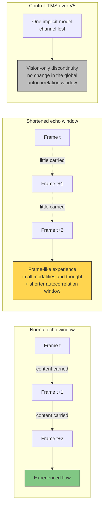

# Prediction 7: Shortening the Echo Window Makes Experience Frame-Like in Every Modality at Once

**A manipulation that shortens the window over which each frame's content persists into the next should make experience frame-like in all sensory modalities and in thought together, and the size of the effect should covary with the shortening of the brain's temporal integration window.**

## The Prediction

Under such a manipulation, experience should come apart into "single frames, step by step". The change should appear in every sensory modality and in thought at the same time, and its size should covary with how far the brain's temporal integration window shortens.

## Derivation

The prediction comes from the third principle by way of the theory's **temporal echo** mechanism. On the theory's account, conscious processing runs in computational frames, each one cycle of the recursive self-simulation. Under [self-referential closure](../core-architecture/self-referential-closure.md), each frame reverberates through the recursive levels and bleeds into the next. That carrying, modelled as the recent past of a perspective, is the experienced flow of time. Less carrying should mean less flow.

The reverberation runs through the explicit simulation as a whole, so the loss should not be tied to one sensory pathway. The theory leaves frame duration open, and the prediction therefore targets the smearing window and makes no claim about a frame rate.

## Figure

*Each frame of the self-simulation carries its content into the next, and that carrying is experienced as flow. Shortening it should make experience frame-like everywhere at once and shorten the neural autocorrelation window. Losing a single sensory channel should produce a discontinuity in that channel only.*

## Proposed Test

A placebo-controlled crossover study with THC at two doses, about 40 occasional users, and eye tracking. Occasional users are chosen because frequent users show tolerance in timing tasks (Sewell et al., 2013).

- **Neural measure.** The autocorrelation window of EEG or MEG (Honey et al., 2012; Golesorkhi et al., 2021), which already separates states of consciousness (Huang et al., 2018; Zilio et al., 2021).
- **Behavioural measures.** Two-flash fusion and simultaneity thresholds (Samaha & Postle, 2015), with auditory and cognitive analogues.
- **Report.** Per-modality items on frame-like experience, built on Melges's construct of temporal disintegration (Melges et al., 1970). The items have to be validated.
- **Control.** TMS over V5 produces transient motion blindness (Beckers & Zeki, 1995). The theory reads this as the loss of an implicit-model channel and predicts a vision-only discontinuity with no change in the global autocorrelation window.

### A Planned In-Silico Test

The same account can be tested in a closed artificial architecture. Cut the carrying of the self-model's own state from one frame into the next while keeping closure within each frame. The self-model should then lose its representation of its own elapsed time and of the order of its own past states, while the world model's representation of external time survives.

The design has three arms: closure with carrying, closure with carrying cut, and recurrence without closure. "Time since my action" and "order of my last two actions" are decoded linearly from self-model units and from world-model units, and the prediction is the interaction. It fails if the cut arm decodes its own elapsed time from self-model units as well as the full arm does. It tests representation, not experience, the standard the theory applies to self-recognition. It has not yet been run.

## Falsification Conditions

The reverberation account of temporal flow is wrong if any of the following holds:

- Frame-like reports occur without a shorter autocorrelation window.
- The window shortens without frame-like reports.
- The reports are confined to vision or locked to saccades.

## Distinguishing Power

- **Discrete-perception accounts** (VanRullen, 2016; Herzog et al., 2020) also predict stroboscopic experience. They tie it to a slower perceptual cycle, a lower alpha peak frequency.
- **The Four-Model Theory** ties it to the smearing window and predicts that alpha frequency need not move.

The prediction is contested on mechanism and shared in part on the phenomenon.

## Key Takeaway

On FMT, the flow of experience is each frame's content carried into the next. Shortening that carrying should make experience frame-like in every modality at once, in step with a shorter neural autocorrelation window, while the alpha frequency need not change.

## See Also

- [Self-Referential Closure](../core-architecture/self-referential-closure.md)
- [Virtual Qualia](../hard-problem/virtual-qualia.md)
- [The Real/Virtual Split](../core-architecture/real-virtual-split.md)
- [Engineering Specification for Artificial Consciousness](../ai-consciousness/engineering-specification.md)
- [Prediction 6: A Simulated Generation Account Reduces Felt Mystery](prediction-6-felt-mystery.md)
- [Prediction 8: Disrupting the Self-Model Lowers Pain Unpleasantness More Than Pain Intensity](prediction-8-pain-affect.md)
- [The FMT Prediction Map](prediction-map.md)

## References

- Beckers, G., & Zeki, S. (1995). The consequences of inactivating areas V1 and V5 on visual motion perception. *Brain*, 118(1), 49–60. https://doi.org/10.1093/brain/118.1.49
- Golesorkhi, M., Gomez-Pilar, J., Zilio, F., Berberian, N., Wolff, A., Yagoub, M.C.E., & Northoff, G. (2021). The brain and its time: Intrinsic neural timescales are key for input processing. *Communications Biology*, 4, 970. https://doi.org/10.1038/s42003-021-02483-6
- Herzog, M.H., Drissi-Daoudi, L., & Doerig, A. (2020). All in good time: Long-lasting postdictive effects reveal discrete perception. *Trends in Cognitive Sciences*, 24(10), 826–837. https://doi.org/10.1016/j.tics.2020.07.001
- Honey, C.J., Thesen, T., Donner, T.H., Silbert, L.J., Carlson, C.E., Devinsky, O., Doyle, W.K., Rubin, N., Heeger, D.J., & Hasson, U. (2012). Slow cortical dynamics and the accumulation of information over long timescales. *Neuron*, 76(2), 423–434. https://doi.org/10.1016/j.neuron.2012.08.011
- Huang, Z., Liu, X., Mashour, G.A., & Hudetz, A.G. (2018). Timescales of intrinsic BOLD signal dynamics and functional connectivity in pharmacologic and neuropathologic states of unconsciousness. *Journal of Neuroscience*, 38(9), 2304–2317. https://doi.org/10.1523/JNEUROSCI.2545-17.2018
- Melges, F.T., Tinklenberg, J.R., Hollister, L.E., & Gillespie, H.K. (1970). Marihuana and temporal disintegration. *Science*, 168(3935), 1118–1120. https://doi.org/10.1126/science.168.3935.1118
- Samaha, J., & Postle, B.R. (2015). The speed of alpha-band oscillations predicts the temporal resolution of visual perception. *Current Biology*, 25(22), 2985–2990. https://doi.org/10.1016/j.cub.2015.10.007
- Sewell, R.A., Schnakenberg, A., Elander, J., Radhakrishnan, R., Williams, A., Skosnik, P.D., Pittman, B., Ranganathan, M., & D'Souza, D.C. (2013). Acute effects of THC on time perception in frequent and infrequent cannabis users. *Psychopharmacology*, 226(2), 401–413. https://doi.org/10.1007/s00213-012-2915-6
- VanRullen, R. (2016). Perceptual cycles. *Trends in Cognitive Sciences*, 20(10), 723–735. https://doi.org/10.1016/j.tics.2016.07.006
- Zilio, F., Gomez-Pilar, J., Cao, S., Zhang, J., Zang, D., Qi, Z., Tan, J., Hiromi, T., Wu, X., Fogel, S., Huang, Z., Hohmann, M.R., Fomina, T., Synofzik, M., Grosse-Wentrup, M., Owen, A.M., & Northoff, G. (2021). Are intrinsic neural timescales related to sensory processing? Evidence from abnormal behavioral states. *NeuroImage*, 226, 117579. https://doi.org/10.1016/j.neuroimage.2020.117579

*Based on: Gruber, M. (2026). The Four-Model Theory of Consciousness, Sections 3.4.4, 8.8 and 8.12. Zenodo. [10.5281/zenodo.18669891](https://doi.org/10.5281/zenodo.18669891)*
