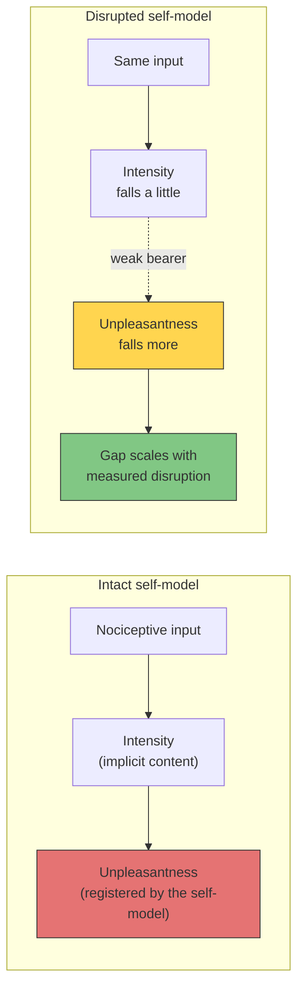

# Prediction 8: Disrupting the Self-Model Lowers Pain Unpleasantness More Than Pain Intensity

**When the explicit self-model is disrupted, pain unpleasantness should fall more than pain intensity, and the size of that gap should scale with measured self-model disruption, not with drug dose or with expectancy.**

## The Prediction

A pain has two dimensions that people can rate separately: how strong it is and how bad it feels. The prediction concerns the difference between them. Under a disruption of the self-model, such as ego dissolution or depersonalization, both ratings may drop, but the drop in unpleasantness should be larger, and the gap should grow with how strongly the self-model is disrupted.

## Derivation

The prediction comes from the third principle by way of the theory's account of [virtual qualia](../hard-problem/virtual-qualia.md): qualia are the way the explicit self-model registers its own states, and the simulation is where hedonic valence is registered (see [dual evaluation](../mechanisms/dual-evaluation.md)). The intensity of a pain is content generated from the nociceptive implicit models. Its unpleasantness is that content registered by the explicit self-model as bad for the self it models. Disrupting the explicit self-model therefore removes the bearer the pain is bad for faster than it removes the sensation.

The claim is relative. A self-model disruption can also change the sensory dimension (Röder et al., 2007; Riegner et al., 2023), so the theory predicts the difference between the two drops, not an intensity that stays fixed.

## Figure

*Intensity is carried by content from the nociceptive implicit models; unpleasantness needs a self it is bad for. Weakening the self-model should therefore lower unpleasantness more than intensity, in proportion to the disruption.*

## Proposed Tests

**A psilocybin design.** A randomized, double-blind, within-subject crossover in healthy volunteers: placebo, a psilocybin dose below the range that produces ego dissolution, a dose within it, and an active placebo matched for expectancy.

- **Pain.** Tonic heat or cold-pressor pain at calibrated intensity, delivered at peak effect, with separate ratings of intensity and unpleasantness after each stimulus (Rainville et al., 1999).
- **Self-model disruption.** The Ego-Dissolution Inventory (Nour et al., 2016), the 5D-ASC (Studerus et al., 2010) and the depersonalization scale of the CADSS, at the same time point. Expectancy is measured before dosing.
- **Analysis.** The dependent variable is the within-subject gap, the drop in unpleasantness minus the drop in intensity, which is the measure Lee et al. (2013) used for THC. It is regressed on ego dissolution with plasma level and expectancy as covariates.

An existing dataset comes close: the Maastricht psilocybin trial in fibromyalgia (NCT06368492) records pain tolerance, ego dissolution, 5D-ASC, CADSS and expectancy, but registers only one pain rating.

**A design without a drug.** Contact athletes already find pain less bothersome within months, while their intensity ratings change only after years (Thornton et al., 2017, 2019). In the five studies that rated athletes' unpleasantness as well as intensity, mostly of endurance and track athletes, the two fell together or not at all (Thornton et al., 2024), which is what the theory expects from exposure without a change in the self-model. The bothersomeness pattern confounds exposure with appraisal. Four groups matched on training hours separate them:

1. a contact martial art with formal mental training (meditation before and after practice);
2. a contact martial art without it;
3. a non-contact practice with the same mental training;
4. non-athletes.

At calibrated equal intensity, the theory predicts the largest gap in the first group, tracking its depersonalization and self-referential processing scores, while threshold and intensity differences follow exposure, not mental training.

## Falsification Conditions

The account of valence as registered by the explicit self-model is wrong if any of the following holds:

- Unpleasantness and intensity fall together at doses that dissolve the self-model.
- The gap is fully explained by dose or expectancy, with ego dissolution adding nothing once both are covaried.
- Ego dissolution predicts the intensity drop rather than the gap.

## Distinguishing Power

- **The dissociation itself is not the theory's.** The two pain dimensions are known to come apart (Rainville et al., 1997; Perlman et al., 2010; Lee et al., 2013).
- **The coarse prediction is shared.** Gerrans (2020, 2024) already argues, in active-inference terms, that pain suffering is anchored by a self-model.
- **Precision accounts without a self-model term** predict that matched expectancy produces a matched gap. The theory predicts that self-model disruption explains the gap after expectancy is covaried out, and that the gap appears with ego dissolution rather than with dose.
- **The closest existing test points the other way for one half.** In mindfulness, thalamus–precuneus decoupling tracked the drop in intensity, not in unpleasantness (Riegner et al., 2023).

Uniqueness: shared in part.

## Key Takeaway

On FMT, a pain is bad for someone only when there is a self-model to register it. Weakening that self-model should therefore take more of the badness away than of the sensation, and the size of that difference should follow the measured disruption of the self, not the dose or the expectation.

## See Also

- [Virtual Qualia](../hard-problem/virtual-qualia.md)
- [Dual Evaluation](../mechanisms/dual-evaluation.md)
- [Ego Dissolution](../phenomena/ego-dissolution.md)
- [Psychedelics](../phenomena/psychedelics.md)
- [Meditation](../phenomena/meditation.md)
- [Prediction 7: Shortening the Echo Window Makes Experience Frame-Like](prediction-7-echo-window.md)
- [The FMT Prediction Map](prediction-map.md)

## References

- Gerrans, P. (2020). Pain asymbolia as depersonalization for pain experience. An interoceptive active inference account. *Frontiers in Psychology*, 11, 523710. https://doi.org/10.3389/fpsyg.2020.523710
- Gerrans, P. (2024). Pain suffering and the self. An active allostatic inference explanation. *Neuroscience of Consciousness*, 2024(1), niae002. https://doi.org/10.1093/nc/niae002
- Lee, M.C., Ploner, M., Wiech, K., Bingel, U., Wanigasekera, V., Brooks, J., Menon, D.K., & Tracey, I. (2013). Amygdala activity contributes to the dissociative effect of cannabis on pain perception. *Pain*, 154(1), 124–134. https://doi.org/10.1016/j.pain.2012.09.017
- Nour, M.M., Evans, L., Nutt, D., & Carhart-Harris, R.L. (2016). Ego-dissolution and psychedelics: Validation of the Ego-Dissolution Inventory (EDI). *Frontiers in Human Neuroscience*, 10, 269. https://doi.org/10.3389/fnhum.2016.00269
- Perlman, D.M., Salomons, T.V., Davidson, R.J., & Lutz, A. (2010). Differential effects on pain intensity and unpleasantness of two meditation practices. *Emotion*, 10(1), 65–71. https://doi.org/10.1037/a0018440
- Rainville, P., Duncan, G.H., Price, D.D., Carrier, B., & Bushnell, M.C. (1997). Pain affect encoded in human anterior cingulate but not somatosensory cortex. *Science*, 277(5328), 968–971. https://doi.org/10.1126/science.277.5328.968
- Rainville, P., Carrier, B., Hofbauer, R.K., Bushnell, M.C., & Duncan, G.H. (1999). Dissociation of sensory and affective dimensions of pain using hypnotic modulation. *Pain*, 82(2), 159–171. https://doi.org/10.1016/S0304-3959(99)00048-2
- Riegner, G., Posey, G., Oliva, V., Jung, Y., Mobley, W., & Zeidan, F. (2023). Disentangling self from pain: Mindfulness meditation-induced pain relief is driven by thalamic–default mode network decoupling. *Pain*, 164(2), 280–291. https://doi.org/10.1097/j.pain.0000000000002731
- Röder, C.H., Michal, M., Overbeck, G., van de Ven, V.G., & Linden, D.E. (2007). Pain response in depersonalization: A functional imaging study using hypnosis in healthy subjects. *Psychotherapy and Psychosomatics*, 76(2), 115–121. https://doi.org/10.1159/000097970
- Studerus, E., Gamma, A., & Vollenweider, F.X. (2010). Psychometric evaluation of the Altered States of Consciousness Rating Scale (OAV). *PLoS ONE*, 5(8), e12412. https://doi.org/10.1371/journal.pone.0012412
- Thornton, C., Sheffield, D., & Baird, A. (2017). A longitudinal exploration of pain tolerance and participation in contact sports. *Scandinavian Journal of Pain*, 16(1), 36–44. https://doi.org/10.1016/j.sjpain.2017.02.007
- Thornton, C., Sheffield, D., & Baird, A. (2019). Motor performance during experimental pain: The influence of exposure to contact sports. *European Journal of Pain*, 23(5), 1020–1030. https://doi.org/10.1002/ejp.1370
- Thornton, C., Baird, A., & Sheffield, D. (2024). Athletes and experimental pain: A systematic review and meta-analysis. *The Journal of Pain*, 25(6), 104450. https://doi.org/10.1016/j.jpain.2023.12.007

*Based on: Gruber, M. (2026). The Four-Model Theory of Consciousness, Sections 3.4.2, 4.2.1 and 8.9. Zenodo. [10.5281/zenodo.18669891](https://doi.org/10.5281/zenodo.18669891)*
