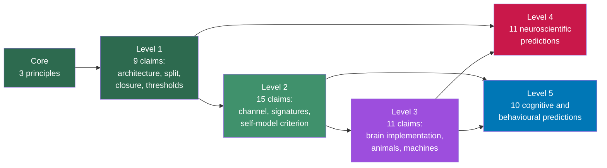

# The FMT Prediction Map

**The prediction map draws the Four-Model Theory as a network of 59 claims and predictions joined by 96 dependencies, so that one can see which predictions rest on which claims and which claims carry the most of the theory.**

A theory of consciousness is a set of principles plus layers of auxiliary claims that turn the principles into something testable. When a prediction fails, the question is which claim it takes down with it. A prediction map answers that question by drawing every claim as a box and every dependency as an arrow. The interactive version is hosted at [matthiasgruber.com/fmt-map](https://matthiasgruber.com/fmt-map/).

## The Format

The map follows the method of [Negro, Elbaz, Fischer, Schreiber and Mudrik (2026)](https://doi.org/10.31234/osf.io/kqr87_v1), who mapped the major theories of consciousness this way. Each arrow means "holds in virtue of": the claim at the arrowhead depends on the claim at the tail, logically though not necessarily deductively. Arrows between levels are solid, arrows within a level are dashed.

The claims sit on six levels. The **core** holds the theory's three principles: free modelling, a second computational level in recurrent dynamics, and phenomenology located on that level. **Level 1** unpacks them into the [four model kinds](../core-architecture/four-model-theory.md), the [real/virtual split](../core-architecture/real-virtual-split.md), [self-referential closure](../core-architecture/self-referential-closure.md) and the thresholds for consciousness. **Level 2** develops those, **level 3** holds claims about the brain and extrapolations to animals and machines, **level 4** neuroscientific predictions and **level 5** cognitive and behavioural ones. FMT's principles describe a computational substrate, not the brain, so the map uses the layout Negro et al. give for substrate-general theories such as Integrated Information Theory.

Each claim also carries a colour for its class (cognitive, substrate-general, brain-specific, extrapolation), a status (principle, derived, corroborated, novel and untested, candidate), a note on whether rival theories make the same prediction, the section of the [FMT paper](https://doi.org/10.5281/zenodo.18669891) it comes from, and its references.

## What the Centrality Measures Show

Negro et al. score each claim with four network measures. **Local reaching centrality** is the share of other claims that depend on it. **Harmonic centrality** weights that count by distance. **Betweenness** is the share of shortest paths through it. **PageRank** is the weight a claim inherits from the claims above it; the authors use it to mark high-stakes predictions.

- **Reach.** After the core, the architecture of two model kinds on two axes reaches furthest: 79% of the other claims depend on it. The real/virtual split (47%) and closure (40%) follow.
- **Bridges.** The real/virtual split has the highest betweenness. It links the principles to the anaesthesia and working-memory predictions and to the [permeability](../mechanisms/variable-permeability.md) cluster, so evidence against the implicit/explicit dissociation would cut more paths through the theory than evidence against any other single claim.
- **Highest PageRank.** [Lucid-dream onset as a criticality crossing](prediction-4-lucid-dreaming.md) ranks first, because it rests on a claim with three parents, one of them the [criticality](../physical-foundations/criticality.md) signature. A null result on lucid onset refutes the criticality signature, not the theory: near-criticality is a contingent mark of free modelling in neural tissue, neither necessary nor sufficient for consciousness. PageRank counts parents and cannot represent that distinction. Next come the [qualia-structure dissociation](prediction-5-qualia-structure.md), the content of [ego dissolution](prediction-2-ego-dissolution.md), the [white-box trace](white-box-trace.md) and the [alter gradient in DID](prediction-3-did.md).
- **A low rank that does not mean low stakes.** The novel-input probe tests the free-modelling principle directly but ranks 43rd of 59, because a root claim passes on only the base PageRank share.
- **Claims without empirical consequence.** Temporal echo, the [meta-problem](../hard-problem/meta-problem.md) and the dissolution of binding have no predictions below them on the map. [Virtual qualia](../hard-problem/virtual-qualia.md) reaches one.

## Using the Map

The [hosted viewer](https://matthiasgruber.com/fmt-map/) shows the full text of every claim and the justification of every arrow, sizes the boxes by any of the four measures, and offers the map as two downloads: the full JSON and a file that opens in the authors' own app, which allows the FMT map to be set beside the published maps of other theories. The FMT map was drawn by the theory's author following the method; Negro et al. did not build or review it.

## Figure

*The level structure of the FMT prediction map: three core principles, three levels of auxiliary claims, and two levels of predictions, 59 boxes in all. Arrows in the full map run from each claim to the claims that hold in virtue of it, and can skip levels, as the arrows from level 1 to level 4 and from level 2 to level 5 indicate.*

## Key Takeaway

Drawn as a dependency network, the Four-Model Theory rests most heavily on its architecture of two model kinds and on the real/virtual split; its highest-PageRank prediction, lucid-dream onset, tests the criticality signature rather than the core principle.

## See Also

- [Confirmed Predictions (Post-2015 Convergence)](confirmed.md)
- [Prediction 4: Lucid Dream Onset Is a Criticality Crossing](prediction-4-lucid-dreaming.md)
- [Deciding Consciousness Without Report: The White-Box Trace](white-box-trace.md)
- [The Real/Virtual Split](../core-architecture/real-virtual-split.md)
- [Criticality: Signature, Not Requirement](../physical-foundations/criticality.md)
- [COGITATE and Adversarial Collaborations](../comparative/cogitate.md)

---

Based on: Gruber, M. (2026). The Four-Model Theory of Consciousness. Zenodo. https://doi.org/10.5281/zenodo.18669891
