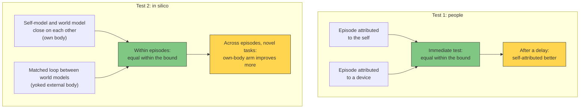

# What Self-Reference Adds: Two Planned Tests

**On the Four-Model Theory, self-reference changes what a system writes back into its own substrate and leaves its performance within an episode unchanged; one test with people and one in silico are designed to find that pattern or refute it.**

The [explicit self-model](../core-architecture/explicit-self-model.md) and the [explicit world model](../core-architecture/explicit-world-model.md) are models in one format that differ in what they are pointed at. The theory therefore claims no operation that the self-model performs and the world model could not: a sufficiently elaborated world model could reach any competence the self-model reaches, at a higher price ([Cognitive Learning vs. Reinforcement Learning](../bridge/cognitive-vs-reinforcement.md)). If self-reference adds nothing to what the shared processing computes, its effect should show in learning: in which episodes are consolidated into the [implicit models](../core-architecture/real-virtual-split.md), and how strongly.

## Where Self-Reference Acts

Which moments are written back into the substrate is gated. Assigning an episode to the self is among the things that raise it above that threshold: choosing an option strengthens its later learning and consolidation ([Cockburn et al., 2014](https://doi.org/10.1016/j.neuron.2014.06.035); [Murty et al., 2019](https://doi.org/10.1162/jocn_a_01321); [Luettgau et al., 2020](https://doi.org/10.1038/s41467-020-17192-7)). On the theory, the tag the self-model applies does the work, whether or not the control it reports was real. A mistaken attribution should therefore carry the same consequence as a correct one.

Two consequences follow for any comparison in which self-reference is the only difference. Within an episode the two conditions compute the same thing, so performance should match. Later, once consolidation has acted, the self-referred condition should come out ahead.

## Test 1: Attributed to the Self or to a Device

People encode episodes under matched conditions: the same stimuli, the same contingency between response and outcome, the same responses. Only the attribution differs. In one condition the episode is attributed to the participant, in the other to a device.

- **Predicted pattern.** The two kinds of episode are remembered equally well at an immediate test, within a bound fixed in advance, and the self-attributed ones better after a delay. Reward cues already produce that shape ([Murayama & Kitagami, 2014](https://doi.org/10.1037/a0031992)).
- **Attribution against control.** Encoding under an illusory sense of agency, with the actual contingency held at zero, should show the same consolidation benefit as veridical agency if the attribution is the operative variable, and none if the agency signal merely tracks instrumental relevance.
- **Refuted by** an immediate advantage beyond the bound, or no delayed advantage.
- **Status.** Not yet run.

## Test 2: A Loop Pointed at the Own Body or at a Yoked Body

This test runs on one artificial substrate, with plasticity on and no self label given to the learning rule. Two arms carry the task through loops matched in firing rate and dimensionality:

- **Own-body arm.** The self-model and the world model close on each other ([self-referential closure](../core-architecture/self-referential-closure.md)) while the system tracks its own body.
- **Yoked-body arm.** A loop runs between the current and a projected world model while the system tracks an external body moving on the same trajectories.

Both arms receive the same information about the tracked body, and each model is identified in the activity by what it tracks. The external body does not answer to the system's motor commands, and the core self-model stays anchored where the most salient senses are referred, so the system models the tracked body as external.

- **Predicted pattern.** The task has a single perspective. Within episodes, with both arms competent, performance agrees within an equivalence bound fixed before the run, and the run has the power to reject an advantage of that size. Across episodes, on novel tasks built from the same material, the own-body arm improves more.
- **Refuted by** a within-episode advantage beyond the bound, which refutes the first half, or an absent cross-episode difference, which refutes the second.
- **Status.** Not yet run. It requires a substrate in which explicit models close on each other.

## Distinguishing Power

- **Test 1 shares its coarse effect.** That choosing strengthens consolidation is already reported (Cockburn et al., 2014; Murty et al., 2019; Luettgau et al., 2020). The theory's own content is that the attribution carries the effect with control held at zero, and that the advantage appears only after a delay.
- **Test 2 is the theory's own.** The theories mapped beside FMT on the [prediction map](prediction-map.md) make no prediction about a loop pointed at the system itself against a matched loop pointed at an external body.

Uniqueness: shared in part (Test 1); unique (Test 2).

## Figure

*Both tests compare two conditions that compute the same thing within an episode. The theory places the difference in what each writes back into the substrate, so it should appear only later: after a delay in people, across episodes in silico.*

## Key Takeaway

On the Four-Model Theory, self-reference changes what a system keeps and leaves what it can do within an episode as it was. Both tests look for equality now and a difference later, and a failure of either half refutes the account.

## See Also

- [Self-Referential Closure](../core-architecture/self-referential-closure.md)
- [The Explicit Self Model](../core-architecture/explicit-self-model.md)
- [Cognitive Learning vs. Reinforcement Learning](../bridge/cognitive-vs-reinforcement.md)
- [Dual Evaluation](../mechanisms/dual-evaluation.md)
- [Deciding Consciousness Without Report: The White-Box Trace](white-box-trace.md)
- [The FMT Prediction Map](prediction-map.md)

## References

- Cockburn, J., Collins, A.G.E., & Frank, M.J. (2014). A reinforcement learning mechanism responsible for the valuation of free choice. *Neuron*, 83(3), 551–557. https://doi.org/10.1016/j.neuron.2014.06.035
- Luettgau, L., Tempelmann, C., Kaiser, L.F., & Jocham, G. (2020). Decisions bias future choices by modifying hippocampal associative memories. *Nature Communications*, 11, 3318. https://doi.org/10.1038/s41467-020-17192-7
- Murayama, K., & Kitagami, S. (2014). Consolidation power of extrinsic rewards: Reward cues enhance long-term memory for irrelevant past events. *Journal of Experimental Psychology: General*, 143(1), 15–20. https://doi.org/10.1037/a0031992
- Murty, V.P., DuBrow, S., & Davachi, L. (2019). Decision-making increases episodic memory via postencoding consolidation. *Journal of Cognitive Neuroscience*, 31(9), 1308–1317. https://doi.org/10.1162/jocn_a_01321

*Based on: Gruber, M. (2026). The Four-Model Theory of Consciousness, Sections 4.2.2, 4.2.4 and 8.12. Zenodo. [10.5281/zenodo.18669891](https://doi.org/10.5281/zenodo.18669891)*
