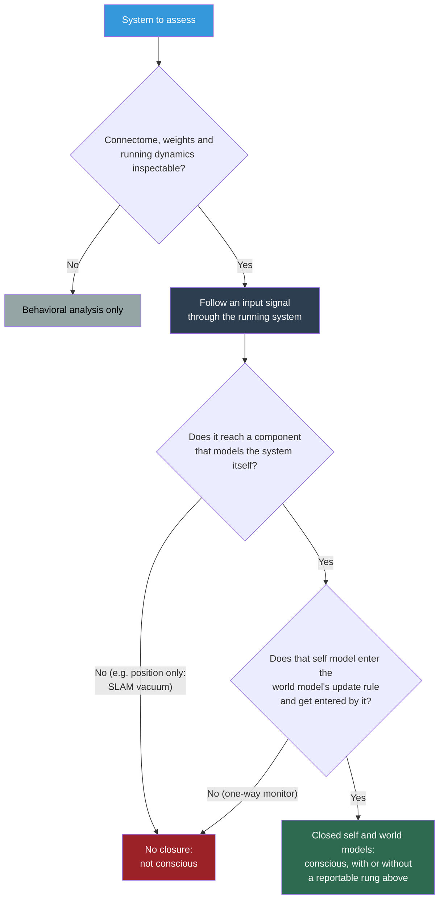

# Deciding Consciousness Without Report: The White-Box Trace

**Where a system can be inspected, the Four-Model Theory does not need the system to say anything: a verdict comes from following an input through the running system and testing whether it reaches a self model closed with the world model.**

Most consciousness science calibrates its markers against report, so it is blind wherever report is absent: in animals, at the [floor of consciousness](../mechanisms/minimal-consciousness.md), and in artificial systems whose reports are cheap to produce. The theory's answer, stated in Table 1b of the master paper, is that "a verdict does not require report. Where the connectome, the weights and the running system are inspectable, a signal entering the system can be traced to the self model, closed with the world model, with or without a reportable rung above it."

## The Procedure

The test is a trace. "Follow an input signal through the running system and test whether it reaches a self-model component that enters the world model's update rule and is entered by it."

Two conditions have to hold together. The signal must reach a component that models the system itself, and that component must be in a two-way relation with the world model: it changes how the world model updates, and the world model changes it. That two-way relation is [self-referential closure](../core-architecture/self-referential-closure.md) made concrete. A component that only reads from the world model, or only writes to it, is a monitor looking in from outside, like the self-monitoring in thermostats and operating-system kernels.

The trace does not ask whether a reportable rung sits above the closure. Report needs recursion above the content, and [minimal consciousness](../mechanisms/minimal-consciousness.md) has none, so "the same trace is the non-report signature of minimal consciousness."

## What Counts as a Self Model: The Robot Vacuum

The trace is only as good as its criterion for "self model," and the criterion is strict at the bottom. "A self model is a model of the system itself, however simple: a realistic representation of the organism — its states, its geometry, its capabilities — in proportion to what the system has. A position estimate alone is not one."

A robot vacuum running simultaneous localization and mapping (SLAM) is the worked negative, and it is instructive because it passes the mutual-update half of the test. Trace a lidar return through it: the return updates the position estimate, the position estimate updates the map, and the map constrains the next position estimate. Something about the system enters the world model's update rule and is entered by it. The vacuum still fails, on four counts the master paper lists: "its 'self' is a position, it has no implicit/explicit split, its algorithm is fixed, and it recruits no free compute for its own modeling." The component the trace reaches is one datum about the machine, not a self model.

The same point applies to biological self-location. "Self-*location* is not self-*reference*: a satellite-navigation unit jointly infers its pose and a map and is not conscious." Joint inference of where one is and what the world is like is necessary and falls short of closure.

## Where It Applies

The procedure is "applicable now to artificial systems, and to nervous systems as they become inspectable. For systems not yet inspectable, behavioral analysis only."

- **Artificial systems.** Weights and running dynamics are open, so closure is "measurable on the system itself" rather than sensed in conversation. This is how the theory reaches its verdict on [large language models](../ai-consciousness/llms-not-conscious.md): a post-trained model carries a reportable representation of its own point of view, and the question is whether anything closes over it.
- **Nervous systems.** As connectomes and recordings of running activity become complete enough to trace, the procedure extends to animals. Until then, for a fish or an insect, "the evidence for it is behavioral analysis only" ([Animal Consciousness](../phenomena/animal-consciousness.md)).

## How It Could Fail

Table 1b gives the procedure its own falsification criterion: "In inspectable systems that also report, a traced signal reaching the closed self and world models while no-report markers of experience of it are absent, or such markers present for a signal the trace shows never reaching the self model." Either mismatch would show that the trace and experience come apart.

This criterion tests the trace as a measuring procedure, which is different from the primary refuter of the bridging identity, the functional twin: a return-free system that does everything the closed one does within the same resource bound ([What Would Refute the Bridge](../hard-problem/dissolution.md)). The trace criterion checks whether closure tracks experience in systems that can report; the twin would show that closure does no work at all.

## Figure

*The white-box trace as a decision procedure. Inspectability decides whether the trace can run at all; the self-model criterion and the two-way update decide the verdict. Report plays no part, which is why the trace can reach minimal consciousness.*

## Key Takeaway

For inspectable systems, the theory decides consciousness by tracing an input to a self model that enters the world model's update rule and is entered by it. A position estimate is not a self model, so a SLAM robot vacuum fails even though its map and position update each other.

## See Also

- [Minimal Consciousness](../mechanisms/minimal-consciousness.md)
- [Self-Referential Closure](../core-architecture/self-referential-closure.md)
- [Explicit Self Model (ESM)](../core-architecture/explicit-self-model.md)
- [The Other-Minds Problem](../limitations/other-minds.md)
- [Why LLMs Are Not Conscious (Under FMT)](../ai-consciousness/llms-not-conscious.md)
- [How FMT Answers the Hard Problem](../hard-problem/dissolution.md)

---

Based on: Gruber, M. (2026). The Four-Model Theory of Consciousness. Zenodo. https://doi.org/10.5281/zenodo.18669891
